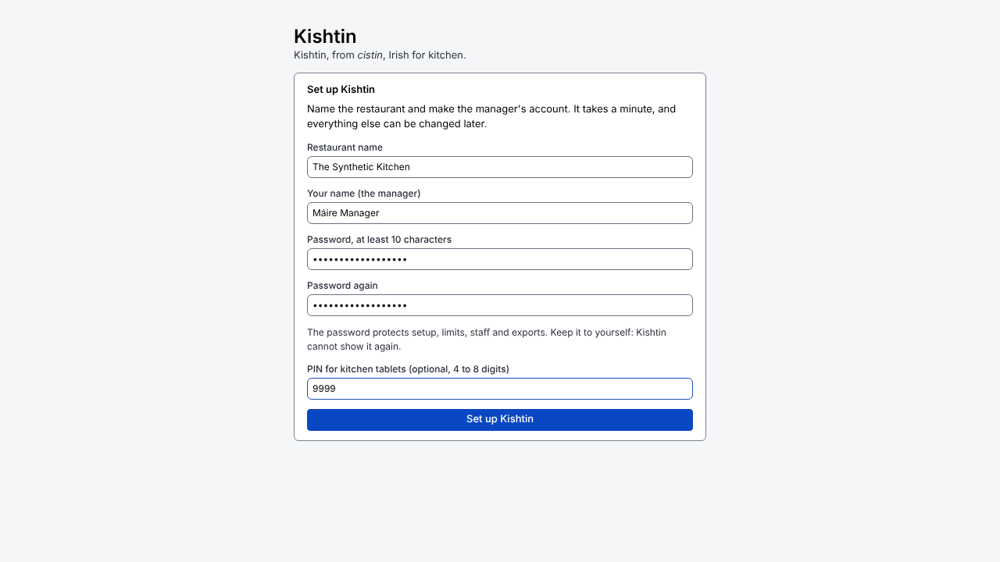
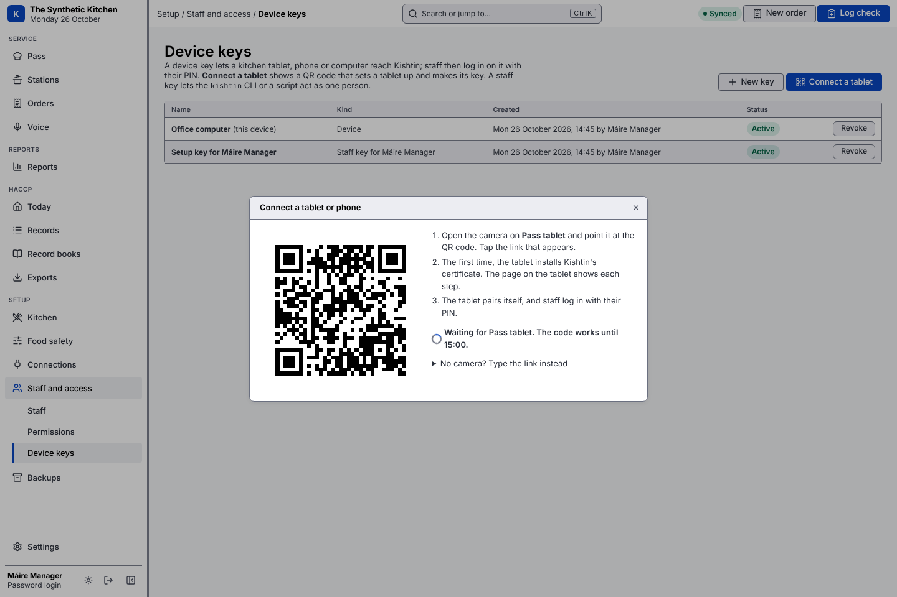
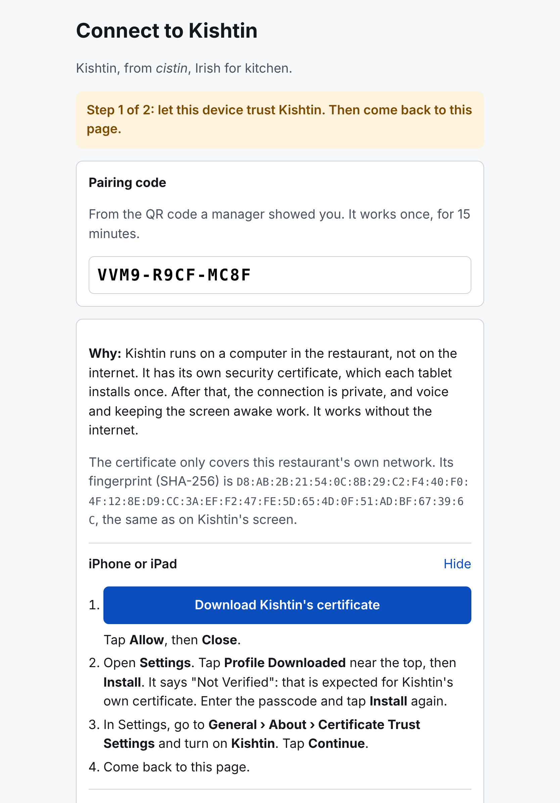

# Getting started with Kishtin

This guide is for the person setting Kishtin up in a restaurant: an owner, manager or head chef. You don't need to be technical. If you can install an app and follow a recipe, you can do this. Set aside about an hour, outside service.

> **Before you start:** no Kishtin release has been published yet, so the install lines in Step 1 will not work until one is. Until then, Kishtin has to be built from its source code by someone technical; see the [README](../README.md#build-from-source).

## How Kishtin is different

Most restaurant systems (Square, Toast, Lightspeed and the like) live **in the cloud**. Your tills, tablets and kitchen screens talk to the company's computers over the internet, and your data is stored there.

Kishtin works the other way round. It runs on **one computer inside your restaurant**, and your tablets and phones talk to that computer over your own Wi-Fi.

| | Cloud systems | Kishtin |
|---|---|---|
| Where your data is kept | On the company's computers | On your computer, in one file you can copy |
| If the internet goes down | Tickets can stop reaching the kitchen | Keeps working: the kitchen doesn't use the internet |
| Who can see your records | You and the company | Only people in your restaurant |
| Account to sign up for | Yes | No |
| Price | Monthly subscription | Free and open source (Apache 2.0 licence) |
| Looking after it | The company does | You do: keep the computer on and copy the backups |

What this means day to day:

- **Your records stay yours.** HACCP checks, orders and staff names never leave the building unless you choose to connect something (for example Square, to bring in till orders). Voice commands are turned into text on your own computer; no recording is sent anywhere.
- **No internet, no problem.** A broken router line or a power cut at the phone exchange doesn't stop service. Tablets keep talking to the Kishtin computer over your Wi-Fi.
- **You are in charge of the computer.** If it is switched off, Kishtin is off. If its disk fails, your records go with it unless you copied the backups somewhere else. This guide shows how.

Kishtin does not take payments. Card payments stay on your Square till and terminal.

## What you need

- **A computer that can stay on during service.** A small PC (often sold as a "mini PC"), a Mac, or a spare laptop is enough. Windows, macOS or Linux all work. Put it somewhere safe from heat, grease and water: the office, not the line.
- **Your restaurant's Wi-Fi**, with the computer connected to it. A network cable from the computer to the router is better than Wi-Fi, if you can.
- **Tablets or phones** for the kitchen: iPads, Android tablets, phones, or a TV with a browser at the pass. Any recent one works.
- **An internet connection for the first install only.** After that, Kishtin doesn't need it.

## Step 1: Install Kishtin on the computer

**On Windows:**

1. Click the Start menu, type **PowerShell**, and open **Windows PowerShell**. A window with a blinking cursor appears.
2. Copy this line, paste it into that window (right-click pastes), and press Enter:

   ```powershell
   irm https://github.com/cathalbyrnegit/kishtin/releases/latest/download/install.ps1 | iex
   ```

**On a Mac:**

1. Press ⌘ and Space together, type **Terminal**, and press Enter.
2. Copy this line, paste it (⌘ V), and press Enter:

   ```sh
   curl -fsSL https://github.com/cathalbyrnegit/kishtin/releases/latest/download/install.sh | sh
   ```

The installer downloads Kishtin, checks that the download is genuine and complete, and installs it. When it finishes it says **Installed** and what to do next. If anything goes wrong, it says what, and installs nothing.

## Step 2: Start Kishtin

In the same window, type `kishtind` and press Enter.

- The first time, the computer asks whether to let Kishtin use the network. **Windows:** tick **Private networks** and click **Allow**. **Mac:** click **Allow**. This is what lets your tablets reach it.
- **Leave this window open.** Closing it stops Kishtin. You can minimise it.

## Step 3: Set up your restaurant

On the **same computer**, open a web browser (Chrome, Edge, Safari or Firefox) and go to:

**http://127.0.0.1:8080**

You see **Set up Kishtin**. Fill in:

- **Restaurant name**: shown on every screen and on inspection packs.
- **Your name**: you become the first manager.
- **Password**, twice: at least 10 characters. It protects setup, limits, staff and exports.
- **PIN** (optional): 4 to 8 digits, for logging in quickly on kitchen tablets.



Click **Set up Kishtin**, then **Open Kishtin**.

> **Write the password down somewhere safe.** Kishtin cannot show it again. A manager can reset another person's password, so make a second manager account (Step 4) in case the first is forgotten. If the only manager's password is lost, there is no way back in through Kishtin today.

## Step 4: Add your staff

Go to **Setup › Staff and access › Staff** and click **Add staff**. For each person, enter their name, their role (head chef, line cook, front of house or manager) and a PIN of 4 to 8 digits. They use the PIN to log in on the kitchen tablets.


Managers also need a password. When someone leaves, deactivate them; their name stays on the records they made, as inspectors expect.

## Step 5: Connect your tablets and phones

Do this once per tablet, with the tablet in your hand, on the restaurant's **staff** Wi-Fi (not a guest network).

1. On the Kishtin computer, go to **Setup › Staff and access › Device keys** and click **Connect a tablet**.
2. Type a name, such as "Pass tablet", and click **Make QR code**.
3. On the tablet, open the **camera**, point it at the QR code, and tap the link that appears.



**The first time, the tablet installs Kishtin's certificate.** The tablet shows the steps for that kind of device, already opened. On an iPad, for example:

1. Tap **Download Kishtin's certificate**, then **Allow**.
2. Open **Settings**, tap **Profile Downloaded**, then **Install**. It says "Not Verified": that's expected.
3. In Settings, go to **General › About › Certificate Trust Settings** and turn on **Kishtin**.
4. Go back to the browser.



Why: the browser only allows the microphone (for voice) and keeping the screen awake on a secure connection. Kishtin isn't on the internet, so it vouches for itself with its own certificate, which each tablet trusts once. It only covers your restaurant's own network.

The tablet notices by itself when the certificate is in place, connects, and shows **Who is logging in?**. The Kishtin computer says the tablet is connected. Staff tap their name and enter their PIN.

## Step 6: Tell Kishtin about your kitchen

Go through these once. Everything can be changed later.

- **Setup › Kitchen › Menu**: your stations (grill, fryer, cold section), the equipment in each and how many it holds ("flat-top: 3 at once"), and each dish with its cook, rest and plate times.
- **Setup › Food safety › Fridges and tasks**: your fridges and freezers by name, and your daily cleaning tasks.
- **Setup › Food safety › Limits and rules**: Kishtin starts with the FSAI's limits (fridges at 5°C or below, cooking to 75°C, and so on). Leave them unless your HACCP plan says otherwise.

## Step 7: Choose what each tablet shows

On each tablet, open the menu (☰) at the top right, or **Settings › This device**, and choose:

- **Pass screen** for the tablet or TV at the pass: every order, ready to fire and serve.
- **Station screen** for a tablet at the grill or fryer: what to start now, and what's coming.
- **Phone** for a phone: fridge checks, logging a check, and taking an order.


## Every day

- **Start Kishtin** after the computer has been switched off or restarted: open PowerShell or Terminal, type `kishtind`, press Enter. Kishtin does not yet start by itself.
- **Fridge checks and cleaning** are on **Today**. Tap **Log check** to record one. A reading out of limit asks what you did about it.
- **Copy the backups every week.** Kishtin makes a backup every 6 hours, but it is on the same computer. Copy the `backups` and `files` folders from Kishtin's data folder (`C:\Users\<you>\.kishtin` on Windows, `.kishtin` in your home folder on a Mac) to a USB stick or another computer. See **Setup › Backups** for where they are.


## If something goes wrong

**A tablet can't find Kishtin.**
- Is the Kishtin computer on, with the `kishtind` window open?
- Is the tablet on the same Wi-Fi as the computer, and not a guest network?
- Did the computer get a new network address? This happens when a router restarts. Make a new QR code and scan it again. To stop it happening, ask whoever looks after your internet to "reserve the address" of the Kishtin computer in the router.

**The tablet says the connection is not private, or not secure.** The certificate step isn't finished. Make a new QR code, scan it, and follow the steps on the tablet again. On an iPad, check that **Certificate Trust Settings** is turned on.

**A screen says "Not connected".** The tablet can't reach the computer right now. It keeps showing what it last knew. Check the Wi-Fi and the computer; it reconnects by itself.

**Voice says "The microphone needs a secure connection".** That device was not connected with a QR code. Connect it as in Step 5.

## Where to go next

- [Screens](screens.md): every page, explained.
- [Install](install.md): updating, other options, and what isn't built yet.
- [HACCP log](haccp.md) and [Record books](record-books.md): checks, exports, and the FSAI booklets.
- [Voice](voice.md): setting up hands-free voice commands.
- [Orders from Square](square.md): bringing in till orders.
