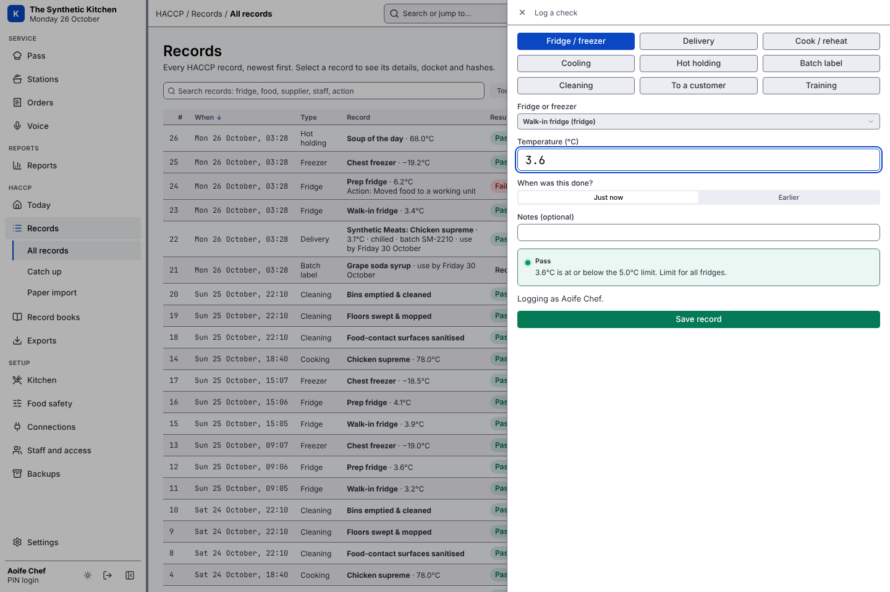
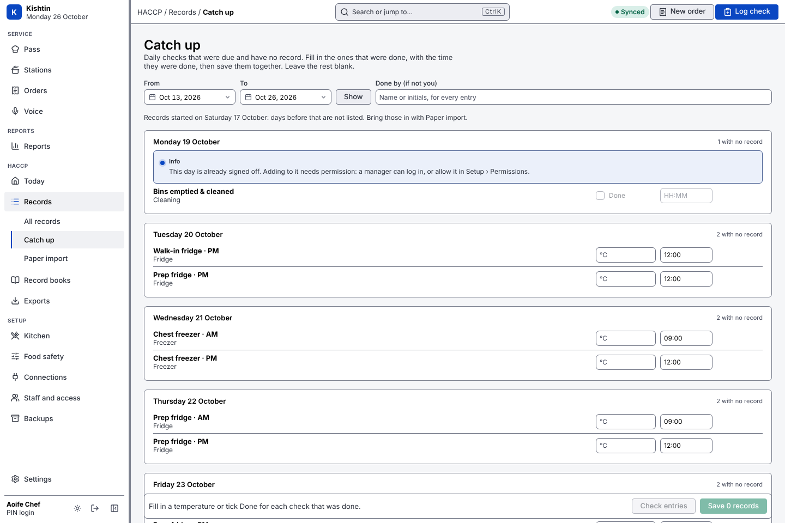
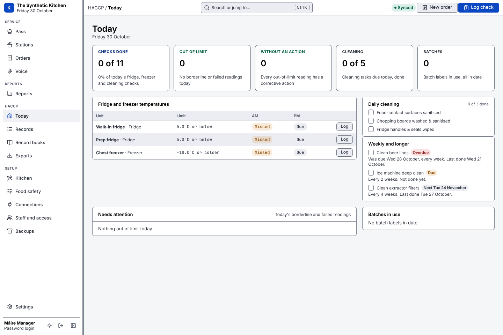
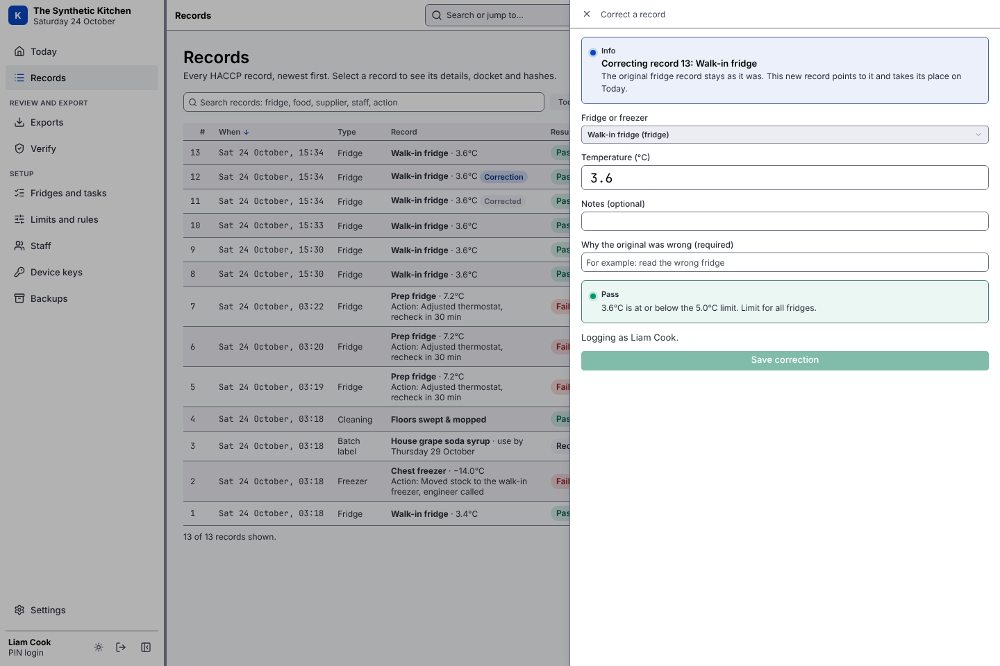
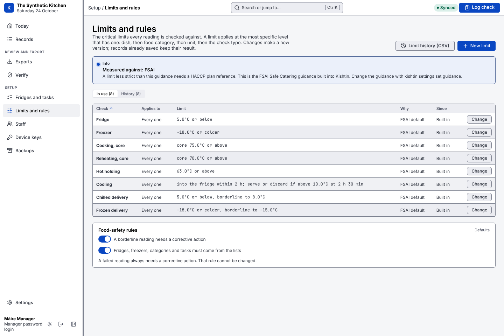
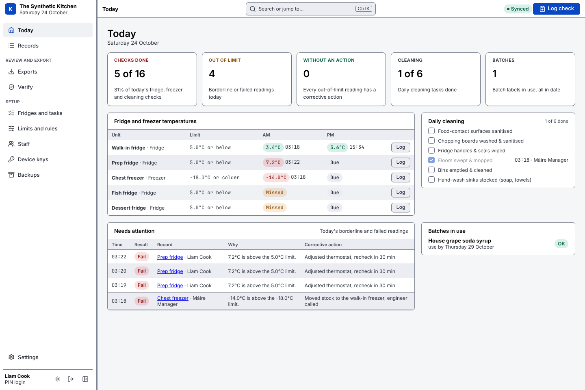
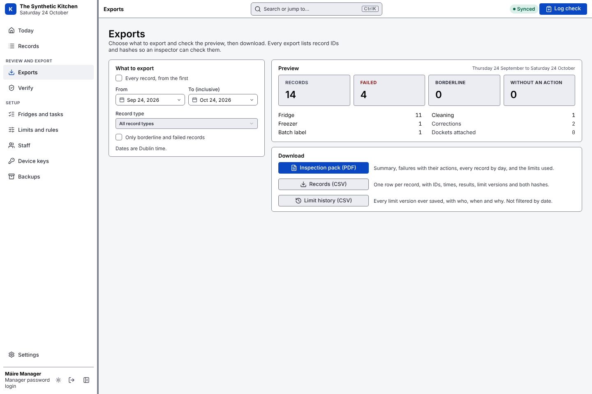
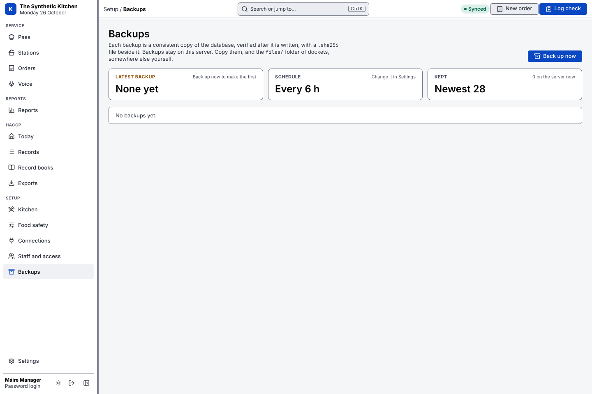

# HACCP log

What Kishtin's HACCP log does today, and what it does not.

## Records

| Type | What you record | Checked against |
|---|---|---|
| `fridge` | unit, temperature | fridge limit (FSAI default ≤ 5°C) |
| `freezer` | unit, temperature | freezer limit (FSAI default ≤ −18°C) |
| `delivery` | supplier, product, chilled/frozen/ambient, temperature, packaging intact, in date; optional batch code, use-by date, delivery vehicle check and docket photo | chilled ≤ 5°C (borderline to 8°C), frozen ≤ −18°C (borderline to −15°C), ambient: no temperature limit. Packaging not intact, not in date, or a vehicle that failed its check fails. |
| `cook` | food, core temperature, optional hold time | core ≥ 75°C, or any time–temperature combination the limit allows |
| `reheat` | food, core temperature, optional hold time | core ≥ 70°C |
| `cooling` | food, cooked at, into fridge at, temperature at 2h30 if late | into the fridge within 2 h; otherwise above 10°C at 2h30 means serve now or discard |
| `hot_hold` | food, temperature | ≥ 63°C |
| `batch_label` | product, made on, use by (or shelf life in days), quantity | no limit; use-by cannot be before made-on |
| `cleaning` | task, area, done or not | not done is a fail; a task can be done once a day |
| `inspection` | the checklist used, each question answered yes, no or not checked, the action taken for each no | any no is a fail; the actions are the corrective action. Head chef or manager. |
| `training` | staff member, in-house topics and trainer or a course and provider, date | no limit. Head chef or manager. |
| `fitness` | staff member, date, reason, fit or not, action taken | no limit; only the outcome is kept. Manager with a password, and only they see these records. |
| `transport` | food, customer, chilled/frozen/hot/ambient, temperature on arrival, raw and ready-to-eat kept apart, optional batch code and use-by | chilled and frozen as deliveries, hot ≥ 63°C (the hot holding limit); not kept apart fails |
| `sign_off` | a manager's sign-off of a period, with what it held when signed | no limit; saved by signing off, not logged as a reading. See [record-books.md](record-books.md#manager-sign-off) |

Delivery results also say what to do: a borderline delivery is accepted only if used or stored straight away; a failed one is rejected.

Temperatures are compared to 0.1°C. A reading exactly on the limit passes. Fridge, freezer, food category and cleaning task names can be fixed to managed lists; see [settings.md](settings.md#lists).

## Results

- **pass**: within the limit.
- **borderline**: outside the target but inside the borderline range (deliveries), or late into the fridge but at or below 10°C at the cutoff (cooling).
- **fail**: outside the limit.
- **recorded**: no limit applies.

A **fail** always needs a corrective action before it can be saved. A **borderline** record needs one too, unless the food-safety rules say otherwise (see [settings.md](settings.md#food-safety-rules)). Each record stores the rules version that applied. Check a reading first, without saving, with `kishtin haccp log … --dry-run` or `POST /api/haccp/check`.

## Closed days

No checks are due on a day the restaurant is closed. Set them in **Setup › Food safety › Fridges and tasks › Closed days**: tick the days closed every week, and add holidays and other closed dates (one day or a run of days, with a note such as "Christmas").

- On a closed day, **Today** says "Closed today" and shows each check as Closed, not Due or Missed.
- The record books print "closed" for a check with no reading, the HACCP report does not count it as missed, and **Catch up** does not list it.
- A check logged on a closed day still counts and prints as usual. Fridges keep running when you are closed: if your HACCP plan says to check them anyway, leave the day open or log the checks.
- It applies to past days too, because it only changes what counts as missed. No record changes. A period a manager already signed off keeps the counts it was signed with.
- Like the other lists, the change is previewed, needs a reason and a manager, and is versioned.

Weekly and longer cleaning tasks still fall due on their day; do them on the next open day.

## Checks logged later

Kitchens do not always log a check the moment it is done. Any record can say when its check was done and who did it:

- On the log form, **When was this done?** › **Earlier** takes a date and time, and **Done by** a name if it was someone else.
- **Catch up** (HACCP › Records › Catch up) lists the checks with no record (fridge and freezer checks and cleaning tasks), by day, from the first day records were kept. Fill in the ones that were done, with the time, and save them together. See [screens.md](screens.md#catch-up).
- From the command line: `kishtin haccp log fridge --unit "Walk-in fridge" --temp 3.4 --at "2026-10-20 09:00" --done-by Liam`, and `kishtin haccp catch-up`.

A record logged later is treated like any other. It shows at the time the check was done in Today, Records, record books, exports and the inspection pack, with the name given. There is no late marker. Its result uses the limits in force when it is saved, like every record. It goes on the end of the hash chain, so the record keeps when it was saved and by whom, as evidence; the record's details show this under Evidence, and the CSV export has both times.

A time in the future is refused. Whether staff may log checks done earlier, and whether they may add to a period already signed off, are set in Setup › Staff and access › Permissions; see [permissions.md](permissions.md). By default anyone may log checks done earlier, and adding to a signed-off period needs a manager with a password.

A correction keeps the time of the record it corrects, unless it gives a different time.

Records brought in from paper keep the photo of the page, when the check was done and the name written on the paper. See [record-books.md](record-books.md#bringing-in-paper-records).

## Logging without a connection

Wi-Fi drops in walk-in fridges and cellars. When a tablet or phone cannot reach the Kishtin computer, the log form says **Not connected to Kishtin** and offers **Keep on this device** in place of **Save record**.

- The check is kept on that device, with the time it was done. A banner on every screen says how many checks are kept **and not in Kishtin yet**. A kept check is not a HACCP record until Kishtin has saved it.
- When the connection is back and the person who kept it is logged in on that device, it is sent by itself (or tap **Send to Kishtin now**). It is saved as a normal record, at the time the check was done, in that person's name. The activity log notes it was entered `offline`.
- Kishtin cannot check a reading against its limit while out of reach. The form asks what you did if the reading is out of limit. If Kishtin finds the reading failed and no action was given, it does not save it: the banner shows why, and you add the action there and send again.
- A check sent twice (the tablet never heard back the first time) is saved once.
- Only the person who kept a check sends it, so the record shows who did it. If someone else is logged in, the banner names who must log in.
- A device keeps at most 200 checks. Clearing the browser's data loses kept checks, as does a private browsing window when it is closed: send them first.

Not kept offline: corrections, a delivery's docket photo, and fitness to work (health information stays off the device). Orders, the pass and settings need the connection.

Once a device has opened Kishtin with a connection, it can open it again without one, so the form is there when needed.

## Printing batch labels

A batch label record prints as a label to stick on the tub. Tap **Print label** beside a batch in **Today › Batches in use**, or on a batch label in **Records**.

The label shows the product, the day it was made, **USE BY** and its date in large type, who made it, and the record number, so a tub can be traced back to its record.

Choose the size next to the button; the device remembers it:

- **62 × 29 mm** and **100 × 50 mm**, for a label printer. The page is exactly the size of the label.
- **A4 page, to cut out**, for an ordinary printer: one label at the top of the page with a line to cut along.

The label opens as a PDF in a new tab; print it from there. The label printer must already be set up on that device: Kishtin does not find or set up printers. `kishtin haccp label ID -o label.pdf --size 62x29`, or `GET /api/haccp/records/{id}/label?size=62x29`.

The label is a copy of the record. If the record was wrong, correct it and print the correction's label.

## Weekly and longer tasks

A cleaning task can be due less often than every day: beer line cleaning every week, an ice machine every two weeks, extractor filters every four weeks. Set **How often** on the task in **Setup › Food safety › Fridges and tasks** (or `every_days` in the lists).

- **When it is due.** A task done every N days falls due N days after it was last done, whatever the day of the week. Doing it early starts the count again from that day. A task never done yet is **Due**, but is never counted as missed, because Kishtin cannot know when it first fell due.
- **Today** lists these tasks under **Weekly and longer**, each with **Overdue** (and the day it was due), **Due today**, **Done**, or **Next** and its date. A task counts as one of today's checks only when it is due, overdue or done today.
- **Catch up** lists an overdue task once, on the day it fell due. Filling it in with the day it was really done moves its next due date on.
- **Reports** show, for these tasks, how many days in the period each was overdue. Daily tasks are counted as before.
- They are recorded as ordinary cleaning records, so the record books, exports and the hash chain treat them like any other.

## Records cannot be changed

There is no way to edit or delete a record, in the screens, the API, the CLI or the store. To fix a mistake, save a new record of the same type with `--corrects <id>` and `--reason`, or use **Correct this record** in Records. The original stays as it was.

Each record stores a SHA-256 hash of its content and of the record before it. `kishtin haccp verify` re-checks the chain from the first record and reports the first break. It also re-hashes every attached file and checks that every record's limit version exists.

What verify cannot catch: if someone deletes the newest records from the end of the chain, what is left still verifies. Compare the chain head (`X-Kishtin-Chain-Head` on exports, `head_hash` from verify and backups) with an older export or backup to catch that.

## Limits

The FSAI defaults are constants in `internal/haccp/limits.go`. The restaurant's own limits are data, changed in **Setup → Food safety → Limits and rules**, with `kishtin limits set`, or with `POST /api/haccp/limits`:

- A limit can apply to a **dish**, a **food category**, a **fridge or freezer unit**, or a whole check type. The most specific one that exists is used, and each record says which level it came from.
- Changing a limit needs a manager logged in with a password (or a manager API key). A PIN is not enough.
- Every change needs a reason. A limit **less strict than your reference guidance** also needs a HACCP plan reference. The guidance starts as the FSAI defaults and can be changed; see [settings.md](settings.md#reference-guidance). The exception is a unit marked non-food, such as a drinks fridge, which only needs a reason.
- A cooking combination counts as less strict unless the guidance has one that is no hotter and held no longer. The FSAI guidance only has 75°C, so 70°C for 2 minutes needs a plan reference until you add it to your guidance.
- Each limit stores the guidance version it was checked against. Previews also say when a limit is below the FSAI defaults, whatever the guidance says.
- A change creates a new version. Old versions are kept, and records already saved keep their result.
- The screen and `kishtin limits set` first show how recent records would have scored under the new limit, then ask before saving.

## Today

`kishtin haccp today` (or `GET /api/haccp/today`, or the Today screen) shows each fridge and freezer check for today as done, due or missed, the cleaning checklist, how many of the day's checks are done, today's out-of-limit records and whether each has an action, and batches in use.

Each unit has daily check times (see [settings.md](settings.md#lists)); by default AM until 12:00 and PM. A reading counts for the check whose time it falls in; the latest reading in a check counts. A check not logged by the time the next one starts is missed. A correction fills the check of the record it corrects.

For the head chef and manager, Today also says when nothing has been signed off for 7 days or more. See [record-books.md](record-books.md#manager-sign-off).

## Exports

`kishtin haccp export --from DATE --to DATE` writes a CSV of the records in that range (both dates inclusive, Dublin time). Each row has the record ID, sequence number, UTC and Dublin times, who logged it, the reading, the result and reason, the corrective action, the limit version, and both hashes.

Leave out `--from` and `--to` for every record; `--type` and `--fails` narrow it further.

`kishtin haccp export --limits` writes the full limit history.

`kishtin haccp export --pdf -o pack.pdf` writes the **inspection pack**: a summary (records, failures, hash chain head, attached file checks, the guidance in use), failed and borderline records with their actions, every record by day, and the limit versions those records were checked against. It takes the same filters.

Text that starts with `=`, `+`, `-` or `@` is prefixed with `'` so spreadsheets do not run it as a formula.

## Docket photos

Upload a JPEG, PNG, WebP, HEIC photo or a PDF, up to `max_upload_mb` (15 MB by default) (`--docket file.jpg` on a delivery, or `POST /api/files`). It is stored under its SHA-256 in the data folder's `files/` folder, marked read-only, and never deleted by Kishtin. Kishtin does not read the docket's contents.

## Backups

On the schedule in the system settings (every 6 hours by default; see [settings.md](settings.md#system-settings)), and on `kishtin backup now`, Kishtin:

1. writes a consistent copy of the database with SQLite's `VACUUM INTO`,
2. opens the copy read-only and verifies its HACCP chain,
3. writes `<backup>.sha256` next to it,
4. removes backups beyond `backup_keep` (28 by default).

Backups stay on the server machine. Copy them somewhere else yourself. Attached files are not in the database backup: copy the `files/` folder too.
