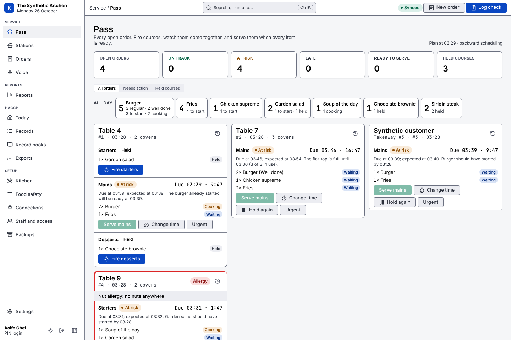

Kishtin, from <em>cistin</em>, Irish for kitchen

# Kishtin documentation

Kishtin is a kitchen system that runs on one computer in your restaurant. Staff log food safety checks on a tablet or phone, the pass sees every open order, and each station is told what to start and when. Everything stays on your computer, in one file you own, and keeps working when the internet drops.

[Get started](getting-started.md){ .md-button .md-button--primary }
[Install](install.md){ .md-button }
[Screens](screens.md){ .md-button }

<section><strong>Yours</strong>One computer, one database file. No cloud account and no subscription.</section>
<section><strong>Offline</strong>The kitchen keeps working with the internet down.</section>
<section><strong>Checked</strong>HACCP records can't be changed, and verify proves it.</section>

The pass: every open order and course, on track, at risk or late. Synthetic data.

## What do you want to do?

| Task | Start here |
| --- | --- |
| Set Kishtin up in a restaurant, step by step | [Getting started](getting-started.md) |
| See everything Kishtin does, and what isn't built yet | [What Kishtin does](features.md) |
| Install, update or uninstall it | [Installing Kishtin](install.md) |
| Encrypt the computer, back up and restore | [Keeping the computer safe](security.md) |
| Connect a tablet or phone | [Connecting a tablet or phone](screens.md#connecting-a-tablet-or-phone) |
| Log fridge, delivery, cooking and cleaning checks | [HACCP log](haccp.md) |
| Print the FSAI Safe Catering booklets | [Record books](record-books.md) |
| Show your records to an environmental health officer | [For your environmental health officer](for-inspectors.md) |
| Set up the menu, stations and equipment | [Menu, orders, the pass and the scheduler](kitchen.md) |
| Run the pass and the station screens | [Screens](screens.md) |
| Fire a course or log a check by voice | [Voice control](voice.md) |
| See how service went, and which checks were missed | [Reports](reports.md) |
| Bring in orders from the till | [Square](square.md) · [SumUp](sumup.md) |
| Change limits, lists and settings | [Settings](settings.md) |
| Let staff do manager jobs | [Permissions](permissions.md) |
| Know what Kishtin keeps, for a privacy notice | [What Kishtin records](recording.md) |
| Build from source or use the command line | [Building and developing Kishtin](developers.md) |

## What it does

<section markdown>
### [HACCP log](haccp.md)
Fridge, freezer, delivery, cooking, cooling, hot holding and cleaning checks, against the FSAI's limits or your own. A failed reading needs a corrective action.
</section>
<section markdown>
### [The pass and stations](kitchen.md)
Every open order in one view. Courses are held until the expo fires them, and every screen updates live.
</section>
<section markdown>
### [Cook scheduler](kitchen.md)
Tells each station what to start and when, so a table's dishes reach the pass together without overloading the grill. It says why for every recommendation.
</section>
<section markdown>
### [Voice control](voice.md)
"Fire table 4 mains", "Walk-in fridge 3.4 degrees". Speech is recognised on the Kishtin computer: no audio leaves the building.
</section>
<section markdown>
### [Record books](record-books.md)
The FSAI's Safe Catering booklets, filled in from the records, with missed checks marked and the manager's sign-off.
</section>
<section markdown>
### [Allergens](kitchen.md#allergens)
The 14 regulated allergens per dish, a chart for customers, and allergy tickets that say what each item contains.
</section>

## Honest limits

Kishtin has not been tested in a working kitchen or reviewed by the FSAI or any environmental health officer. Ask yours before replacing paper records: [the questions to ask](for-inspectors.md#questions-to-ask-your-eho). Backups stay on the Kishtin computer until you copy them off. Screens show the last data they had when the computer can't be reached, but can't save until it is back.

Kishtin is free software under the [Apache License 2.0](https://github.com/CathalByrneGit/Kishtin/blob/main/LICENSE). To report a security problem, see the [security policy](https://github.com/CathalByrneGit/Kishtin/blob/main/SECURITY.md).
