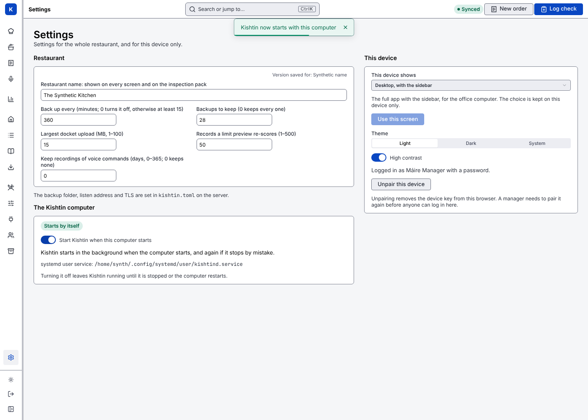
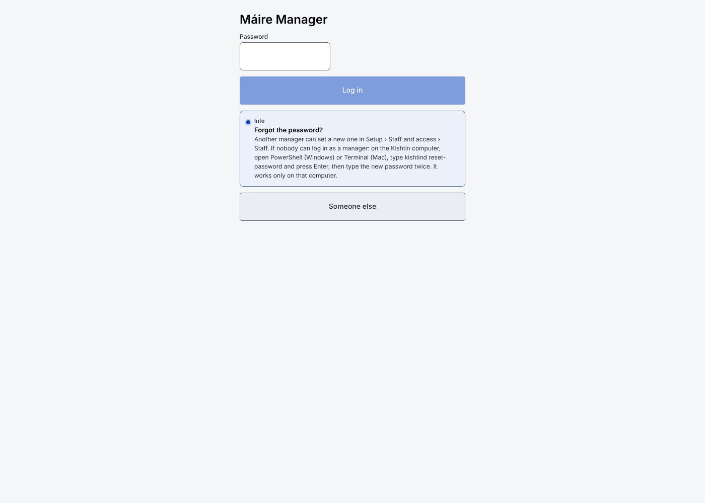

# Installing Kishtin

New to Kishtin? [Getting started](getting-started.md) walks through the whole setup in plain steps, from installing to connecting tablets. This page has the details.

Kishtin runs on one computer in the restaurant, which every screen in the kitchen connects to. It is two programs: `kishtind` (the server) and `kishtin` (the command line). This page installs both from a release.

## What you need

- A computer that stays on in the restaurant: a small PC, a Mac, or an office computer. Linux, macOS or 64-bit Windows, on an Intel/AMD (amd64) or ARM (arm64) processor.
- An internet connection to download Kishtin. After that, Kishtin works without the internet.
- Nothing else. There is no account to make and nothing else to install.

## Install

### Windows

1. Open the Start menu, type **PowerShell**, and open **Windows PowerShell**.
2. Paste this line and press Enter:

   ```powershell
   irm https://github.com/cathalbyrnegit/kishtin/releases/latest/download/install.ps1 | iex
   ```

It puts Kishtin in `%LOCALAPPDATA%\Programs\kishtin\bin` and adds that folder to your PATH, so new PowerShell windows can run `kishtind` by name.

### macOS and Linux

1. Open **Terminal** (on a Mac: press ⌘ Space, type Terminal, press Enter).
2. Paste this line and press Enter:

   ```sh
   curl -fsSL https://github.com/cathalbyrnegit/kishtin/releases/latest/download/install.sh | sh
   ```

It puts Kishtin in `~/.local/bin`. If that folder is not on your PATH, the installer says which line to add to `~/.profile`.

### What the installer checks

Before installing anything, the installer:

- downloads the release for your system and its `SHA256SUMS` list;
- stops unless the list has exactly one entry for that download and the download matches it;
- stops unless the download holds `kishtind` and `kishtin` and nothing else.

If any check fails, it says what went wrong and nothing is installed.

At the end, the installer asks whether Kishtin should **start by itself whenever this computer starts**. Say yes (press Enter) unless you have a reason not to: then nobody has to remember to start it after a restart or a power cut, and Kishtin starts straight away. See [Start with the computer](#start-with-the-computer).

## Start Kishtin and set it up

1. If you said no to starting with the computer, start the server: type `kishtind` and press Enter. Leave the window open: closing it stops Kishtin.
2. On the same computer, open a browser at **http://127.0.0.1:8080**.
3. Fill in **Set up Kishtin**: the restaurant's name, your name and a password. See [Setting Kishtin up](screens.md#setting-kishtin-up).

`kishtind` keeps its data in `~/.kishtin` (on Windows, `C:\Users\<you>\.kishtin`): one database file, attached photos and backups.

## Start with the computer

Kishtin can start by itself, as the person who installed it, with their data folder, using the computer's own start-up settings:

| System | How | When it starts |
|---|---|---|
| Windows | a Task Scheduler task called **Kishtin** | when that person logs in to Windows. Kishtin opens in its own window: leave it open, or minimise it. If it stops by mistake, Windows starts it again within a minute. |
| macOS | a LaunchAgent, `~/Library/LaunchAgents/kishtin.kishtind.plist` | when that person logs in, in the background, and again if it stops by mistake. Its messages go to `kishtind.log` in the data folder. |
| Linux | a systemd user service, `~/.config/systemd/user/kishtind.service` | when the computer starts, if the system lets Kishtin turn on "lingering" for the user; otherwise when the user logs in. `journalctl --user -u kishtind` shows its messages. |

Turn it on or off in any of these ways:

- The installer asks at the end. Set `KISHTIN_STARTUP=yes` or `no` before the install line to answer in advance.
- **Settings › The Kishtin computer › Start Kishtin when this computer starts**, as a manager logged in with the password.
- `kishtind startup on` or `off` on the Kishtin computer, or `kishtin startup on` or `off` from anywhere with an API key. `kishtind startup` says how it stands.



Turning it on while Kishtin is not running starts it straight away. Turning it off leaves a running Kishtin running until it is stopped or the computer restarts. Both are noted in the activity log when done on the screens.

Said plainly:

- **On Windows and a Mac, Kishtin starts when someone logs in, not at power-on.** For a computer that should bring Kishtin back after a power cut with nobody there, set it to log in by itself: on a Mac, **System Settings › Users & Groups › Automatically log in as**; on Windows, ask whoever looks after the computer to set up automatic sign-in.
- On Linux, if the start-up note says so, an administrator runs `sudo loginctl enable-linger <user>` once, so Kishtin starts at power-on without anyone logging in.
- Settings given to `kishtind` in its environment (such as `KISHTIN_DATA_DIR` or `KISHTIN_SQUARE_TOKEN`) are not passed on. Put them in `kishtin.toml`; `kishtind startup` warns about any it sees.
- `kishtind startup stop` stops a Kishtin the computer started, for example to update by hand. Start-up stays on, and `kishtind startup on` starts it again.

## Tablets and phones

Kishtin lets tablets and phones on the restaurant's network use it from the start. Connect each one with a QR code from **Setup › Staff and access › Device keys › Connect a tablet**; see [Connecting a tablet or phone](screens.md#connecting-a-tablet-or-phone).

- Kishtin answers tablets over HTTPS on port 8443, with its own certificate, and on port 8080 with only the page a tablet opens first, which helps it install the certificate. Everything else on port 8080 is for the Kishtin computer itself. Every request still needs a device key, and pairing needs a one-time code from a manager.
- The first time `kishtind` starts, Windows asks whether to allow it on networks, and a Mac whether to accept incoming connections. Allow it on **private** networks only, not public ones.
- Keep tablets on the staff Wi-Fi, not a guest network: guests' phones should not reach the kitchen system at all.
- On a computer with several networks or a VPN, name the address tablets should use in `kishtin.toml`: `tablet_addresses = ["192.168.1.20"]` under `[server]`.
- To keep Kishtin on this computer only, set `tablets = false` under `[server]`.

## Update

Run the same install line again. It replaces the two programs and leaves the data alone. Take a backup in **Setup › Backups** before a big update.

- If Kishtin starts with the computer, the installer stops it, replaces the programs and starts it again.
- If you started Kishtin by hand, stop it first (press Ctrl C in its window), and start `kishtind` again afterwards.

Kishtin brings the database up to date when it starts.

`kishtind --version` shows which version is installed.

## Choices

Set these before the install line:

| Setting | Does |
|---|---|
| `KISHTIN_VERSION=v0.2.0` | installs that release instead of the latest |
| `KISHTIN_INSTALL_DIR=/some/folder` | installs there instead |
| `KISHTIN_RELEASE_URL=https://…` | downloads from a mirror: a folder holding the archives and `SHA256SUMS` |
| `KISHTIN_NO_MODIFY_PATH=1` | Windows only: leaves your PATH as it is |
| `KISHTIN_STARTUP=yes` or `no` | answers the start-with-the-computer question in advance |

For example, on macOS or Linux:

```sh
curl -fsSL https://github.com/cathalbyrnegit/kishtin/releases/latest/download/install.sh | KISHTIN_VERSION=v0.2.0 sh
```

On Windows: `$env:KISHTIN_VERSION = 'v0.2.0'` on its own line first.

## Download by hand

Each release on [GitHub](https://github.com/cathalbyrnegit/kishtin/releases) has one archive per system, and `SHA256SUMS`:

| System | Archive |
|---|---|
| Linux, Intel/AMD | `kishtin_linux_amd64.tar.gz` |
| Linux, ARM (Raspberry Pi 4 and 5, ARM mini PCs) | `kishtin_linux_arm64.tar.gz` |
| Mac with Apple silicon (M1 and later) | `kishtin_darwin_arm64.tar.gz` |
| Mac with Intel | `kishtin_darwin_amd64.tar.gz` |
| Windows, Intel/AMD | `kishtin_windows_amd64.zip` |
| Windows, ARM | `kishtin_windows_arm64.zip` |

Check the archive against its line in `SHA256SUMS` (`sha256sum`, `shasum -a 256`, or `Get-FileHash` on Windows), unpack it, and put `kishtind` and `kishtin` somewhere on your PATH. On a Mac, a file downloaded in a browser is blocked the first time ("cannot be opened"); the install line above avoids that. To allow a hand-downloaded copy, run `xattr -d com.apple.quarantine kishtind kishtin` in its folder.

## Forgotten manager password

Another manager can set a new password in **Setup › Staff and access › Staff**. If nobody can log in as a manager, on the Kishtin computer open PowerShell or Terminal and run:

```sh
kishtind reset-password
```

It asks for the new password twice. It works whether or not Kishtin is running, but only on the Kishtin computer, as the user Kishtin runs as: being able to use that computer account, which already holds Kishtin's data folder, is what allows it. With several managers, add `--name "Their Name"`. If no manager is left (the last one was deactivated), `--name` makes that staff member a manager, or adds a new manager with that name. Every reset is noted in the activity log.

The password login's **Forgot the password?** says the same on the screens.



While Kishtin runs, the command leaves a one-time code in `recovery-code.txt` in the data folder and gives the same code to Kishtin on this computer's own address. Kishtin accepts it once, within 10 minutes, and never from another device. The file is removed straight away.

## Licence

Kishtin is free to use, copy and change under the Apache License, Version 2.0. `kishtind licenses` prints its licence and the licences of the open-source software built into it.

## Uninstall

Run `kishtind startup off` first if Kishtin starts with the computer. Then delete `kishtind` and `kishtin` from where they were installed. Kishtin's data stays in `~/.kishtin` until you delete that folder too. Keep a backup: HACCP records are evidence for inspections.

## Not done yet

Said plainly, so nobody is caught out:

- No release has been published yet, so the install lines above do not work until the first `v*` tag is pushed (see Making a release). Until then, build from source as in the [README](../README.md#build-from-source).
- On Windows and a Mac, Kishtin starts when someone logs in, not at power-on, unless the computer logs in by itself (see [Start with the computer](#start-with-the-computer)). On Windows its window has to stay open.
- Each tablet installs Kishtin's certificate once, by hand, following the steps on its screen. On an iPad that is three screens of Settings.
- If the router gives the Kishtin computer a new address, tablets must be pointed at it again (Kishtin renews its own certificate by itself). Reserve the computer's address in the router to avoid this.
- The programs are not signed by Apple or Microsoft. The install lines above work without warnings; a copy downloaded in a browser may show one.
- There are no click-to-install packages (`.msi`, `.pkg`, `.deb`) yet.

## Making a release

For developers: write the release notes for owners in `docs/releases/<tag>.md` (for example `docs/releases/v0.2.0.md`), merge it to `main`, then push a tag such as `v0.2.0` on `main`. Without a notes file, the release lists the commits since the last one. The Release workflow runs the tests, then GoReleaser builds every archive with the screens embedded, writes `SHA256SUMS`, and publishes them with the two install scripts. Try it locally without publishing with `make release-snapshot` (needs [GoReleaser](https://goreleaser.com) v2); the archives land in `dist/`.
