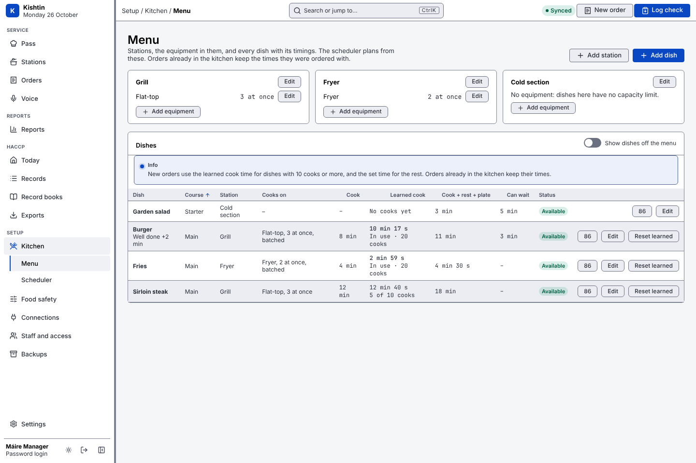

# Menu, orders, the pass and the scheduler

What Kishtin's kitchen side does today, and what it does not. For the screens, see [screens.md](screens.md#service).

## Menu

The menu is three kinds of thing:

| What | Fields | Example |
|---|---|---|
| **Station** | name, position on screens, in use | Grill |
| **Equipment** | station, name, slots (how many units it holds at once), in use | Flat-top, 3 slots |
| **Dish** | name, course, station, equipment (optional), batch capacity, cook / rest / plate time, how long it can wait at the pass, batchable, modifiers, HACCP food category, available (86), on the menu | Burger: flat-top, 8 min cook, 2 min rest, 1 min plate, can wait 3 min, "Well done" +2 min |


- **Capacity.** A dish's batch capacity is how many of it the equipment cooks at once when used for nothing else; it defaults to the equipment's slots. One unit uses 1/capacity of the equipment, so different dishes share it fairly: on a 6-slot grill, a steak with capacity 3 uses twice the room of a burger with capacity 6.
- **No equipment** means no capacity limit, for dishes that are only plated (salads, cold desserts).
- **Modifiers** add to (or take from) the cook time, such as "Well done" +2 min or "Rare" −1 min.
- **Food category** must be one of the HACCP lists' food categories when that list has entries, so the dish's cooking limit applies.
- **86.** Head chefs, line cooks and managers can mark a dish sold out; it cannot be ordered until it is back on.
- Nothing is deleted. Stations, equipment and dishes are taken out of use instead, because past orders refer to them. A station or piece of equipment still used by a dish on the menu cannot be taken out of use.
- Changing the menu needs a manager logged in with a password.

## Orders

An order is a **table** (with a table number) or a **takeaway**. Any order can also have a **name**, such as the guest's: screens then show the name as the order's heading, with the table or takeaway number under it. The name can be added or changed at any time (the change is logged), and voice commands can use it ("fire Aoife mains"). It can have covers, notes for the kitchen, and an allergy flag that every screen highlights. Each order gets a ticket number, counting from 1 each day.


- Each item is one dish, so "2x burger" is two items, cooked and tracked on their own. An item copies its dish's station, equipment, capacity and times (with modifiers applied) when it is ordered, so a menu change does not change an order already in the kitchen.
- Items are grouped into **courses**: starters, mains and desserts. A dish has a usual course; an order can put it in another.
- Front of house, head chefs and managers enter orders and add items to open ones. An item added to a course that has already been fired is fired straight away; a course that has been served takes no more items.

### Firing, cooking and serving

A course is **held** until the expo fires it. Firing sets its **target time**: now plus its longest item's cook, rest and plate time. The head chef or a manager fires; they can also fire courses straight away when entering an order (useful for takeaways).


Items then move through these states:

| State | Means | Who moves it on |
|---|---|---|
| Held | waiting for the course to be fired | the expo, by firing |
| Fired (shown as "Waiting") | at the station, not started | cook: Start |
| Cooking | on the equipment | cook: Done cooking |
| Resting | resting, for dishes with a rest time | cook: Done resting |
| Plating | being plated, for dishes with a plate time | cook: Ready |
| Ready | at the pass | expo: Serve |
| Served | gone to the table | |
| Voided | cancelled, with a reason | expo |

Phases a dish does not have are skipped: fries with no rest time go from cooking to plating. A cook can move an item one step back to undo a tap made by mistake.

When two people tap at once, or one taps on a screen that is out of date, only the first tap counts. Station screens send the state each item was shown in; if any item has already moved on, nothing in that tap moves and the error says who moved it and when. Scripts can do the same with `--from`.

- **Mark ready** puts every started item in a course straight to ready, for when the plates are at the pass but the cooks did not tap Done. It refuses while any item in the course has not been started, so nothing is marked ready that no one cooked. Saying "table 7 ready" does the same.
- **Serve** serves a whole course, and only once every item in it is ready, so a course leaves the pass together.
- **Close** an order once every item is served or voided.
- **Change** an item that was ordered wrong (a burger that should be well done, the wrong dish): the old item is voided and the right one added in its place, in one step, so it can never end up half done. The void reason says what replaced it ("asked for well done by Burger (Well done)"). The new item joins the same course, and goes straight to its station if the course is fired. Front of house can change items in a held course; once the course is fired, only the head chef or a manager can, as with any void.
- Every change goes in the order's **history**: who, when, and what. The history cannot be edited or deleted. Item state changes in it are the actual cook times that [learned cook times](#learned-cook-times) come from.

### Expo overrides

On a fired course the expo can:

- **Change time**: set a new target time, with a reason. It is logged, and the scheduler re-plans around it.
- **Hold again**: un-fire the course, for example when the table has stepped outside. Its items leave the station queues and its target time is cleared; firing it again sets a fresh target. This only works while nothing in the course has started. Once a cook has started an item the food is already cooking, so void or change those items instead.
- **Urgent**: flag the course so the scheduler puts it first. Also logged.


An override always beats the scheduler's settings.

## The scheduler

The scheduler decides what each station should start and when, so every item of a course reaches the pass together, without going over any equipment's capacity. It is a pure function of the kitchen's state, its settings and the time: the same inputs always give the same plan. Kishtin makes a fresh plan whenever a screen asks (after every order, fire, start, finish or void, and every 15 seconds by default), and every plan records the settings version that produced it.


### How backward scheduling works

1. Courses are planned one at a time, in order of target time. A priority (see below) moves a course earlier in that order.
2. For each course, every item not yet started gets a **latest start**: the target time minus its cook, rest and plate time, minus its station's buffer.
3. The longest items choose first. Each starts at its latest start if the equipment has room for its whole cook time. If not, it starts a little earlier, within how long the dish can wait at the pass, and waits there.
4. If an item cannot fit by its latest start, the **whole course moves later**, to the earliest time all its items can finish together. The course then shows **at risk**. Courses planned before it are never pushed back by it.
5. Identical **batchable** items (same dish and modifiers) for different tables start together when their start times fall within the batch window (2 minutes by default), the equipment has room, and the earlier start is no more than the dish can wait.
6. Items already cooking hold their equipment until their cook time ends, and an item already started late sets the earliest the course can be ready.

Every recommendation says why, for example:

> Table 7 mains are due at 19:19. Burger: 8 min cook + 2 min rest + 1 min plate, so start by 19:08. The flat-top is full until 19:08 (3 of 3 in use). The course moved from 19:11 to 19:19 so every item finishes together.

When a course's own items cannot all fit on the equipment at once (two burgers and a steak on a three-burger flat-top), one item starts early and waits at the pass longer than its dish should. The recommendation says so and suggests moving the course later on the pass.

### Course status

| Status | Means |
|---|---|
| On track | expected at the pass by its target |
| At risk | expected after its target, which has not passed yet; the reason says why |
| Late | its target has passed, or it has waited at the pass longer than allowed |
| Ready | every item is at the pass |

### Settings

The scheduler settings are a versioned settings group, changed like the HACCP settings: previewed, with a reason, by a manager logged in with a password. See [settings.md](settings.md#scheduler-settings).


| Setting | Default | Meaning |
|---|---|---|
| `strategy` | `backward` | `backward` as above, or `fifo`: start items in the order their courses were fired, as soon as equipment allows, without target times. |
| `batching` | on | Cook the same dish for several tables at once. |
| `batch_window_seconds` | 120 | How close start times must be to batch. |
| `max_pass_wait_seconds` | 180 | A ready course that waits longer than this counts as late. |
| `priority_allergy` | on | Allergy orders are a priority. |
| `priority_takeaway` | off | Takeaways are a priority. |
| `large_table_covers` | 0 (off) | Tables with at least this many covers are a priority. |
| `priority_lead_seconds` | 120 | Each priority moves a course this much earlier in the planning order. An urgent course counts as two. |
| `station_buffers` | none | Extra seconds before a station's items are due. |
| `replan_seconds` | 15 | How often screens ask for a new plan when nothing changes. |
| `learned_times` | off | New orders use each dish's learned cook time once it has 10 cooks (see below). |

### Learned cook times

Kishtin learns how long each dish really takes from the station screens, so the scheduler can plan with the kitchen's real times instead of the ones typed in on day one.

- **What it learns from.** Every cook of the dish in the last 90 days that was started and marked ready on a station screen: the time from started to ready, less the dish's rest and plate time and any modifier (a well-done burger's extra 2 minutes come off). What is left is the cook time for the plain dish.
- **How.** A smoothed average: each new cook moves the learned time a fifth of the way towards itself, so recent cooks count most and one odd cook moves it little.
- **What it leaves out.** A cook that took under a quarter, or over four times, the time set when it was ordered: most likely someone tapped ready late or early. Voided items, and cooks before the dish was last reset.
- **When it is used.** Only when `learned_times` is on in the scheduler settings, and only for a dish with at least 10 cooks; other dishes keep their set time. It applies to new orders and items added from then on: orders already in the kitchen keep the times they had. Turning it on is reviewed like any settings change, and the review lists each dish's set and learned time.


- **Where to see it.** **Setup › Kitchen › Menu** shows each dish's set and learned cook time, how many cooks it is learned from, and whether new orders use it. An item using a learned time is marked `cook_learned` in the API.
- **Reset.** After a new recipe or new equipment, a manager uses **Reset learned** on the dish (or `kishtin menu learned reset DISH`). Kishtin learns again from the next cook, and the set time is used until there are 10. Each reset is in the activity log.
- **What it does not change.** The cook time set on the menu stays as it is; learned times never overwrite it. Rest and plate times are not learned. Learned times are worked out again at most every 5 minutes.

The golden plans in `internal/scheduler/testdata` show the scheduler's output for fixed kitchens; a change to plan output must update them on purpose.

## Commands

```sh
kishtin menu                                     # every station, its equipment and dishes
kishtin menu station add --name Grill
kishtin menu equipment add --station Grill --name Flat-top --slots 3
kishtin menu dish add --name Burger --station Grill --equipment Flat-top \
  --cook 8m --rest 2m --plate 1m --hold 3m --batchable --modifier "Well done=2m"
kishtin menu dish update burger --hold 4m        # only the flags given change
kishtin menu 86 burger                           # sold out; `kishtin menu on burger` puts it back

kishtin order new --table 4 --covers 2 --item "Salad" --item "2x Burger: well done"
kishtin order new --takeaway --name "Aoife" --item "Burger" --item "Fries" --fire main
kishtin order fire "table 4" main                # orders by ID, #ticket or table
kishtin order target 4 main 19:30 --reason "Table not ready"
kishtin order hold 4 main --reason "Table outside"  # un-fire, while nothing has started
kishtin order urgent "#3" main
kishtin order ready 4 main                       # every started item to ready
kishtin order serve 4 main
kishtin order show 4 --history
kishtin order name 4 "Aoife"                    # "" clears it; orders can then be found by name
kishtin order close 4

kishtin pass --why                               # every fired course: due, expected, status, why
kishtin station grill                            # what to start now and next, and why
kishtin items next ID...                         # one step forward
kishtin items next --from fired ID...            # only if they are still waiting to start
kishtin items move --to voided --reason "Dropped" ID
kishtin items replace ID --with "Burger: well done" --reason "Asked for well done"

kishtin settings show scheduler
kishtin menu learned                             # each dish's set and learned cook time
kishtin menu learned reset Burger                # learn again from the next cook (manager)
```

Every command takes `--json`. The same actions are in the API under `/api/menu`, `/api/orders`, `/api/kitchen` and `/api/settings/scheduler`.

## Not built yet

- Learned rest and plate times. Only the cook time is learned; rest and plate stay as set.
- Named service profiles, replaying a past service under new settings, a fixed pace between courses, and course gaps per service.
- A course can be held again only while nothing in it has started.
- An item's dish or modifiers are not edited in place: **Change** voids it and adds the right one, and both stay in the order's history.

Orders from Square and SumUp, voice control and kept scheduler plans are described in [square.md](square.md), [sumup.md](sumup.md), [voice.md](voice.md) and [recording.md](recording.md).
