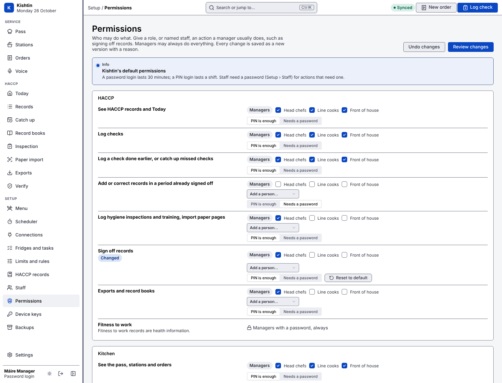

# Permissions

Kishtin decides who may do what by role: head chef, line cook, front of house, manager. Kitchens hand out jobs differently, so a manager can change this in **Setup › Permissions**. For example, a head chef or a named cook can sign off records, run the pass, or do inspections.



## What can be changed

For each action:

- **Roles**: which of head chefs, line cooks and front of house may take it. Managers always may.
- **Named staff**: people who may take it whatever their role, for example one line cook who covers sign-off.
- **Login**: whether a PIN is enough, or the action needs a password login. A password login lasts 30 minutes; a PIN login lasts a shift. Staff other than managers can be given a password in Setup › Staff.

**Reset to default** puts an action back to Kishtin's default.

## What cannot be changed

These are always managers logged in with a password:

- Adding and changing staff, because setting roles could give anyone any access.
- Creating and revoking API keys, because a key acts as a member of staff.
- Changing permissions, for the same reason.
- Fitness to work records, because they are health information.

Managers can always take every action, so nobody can lock the managers out.

## Saving a change

**Review changes** shows each action that changes and who it allows, by name. It warns when a named person needs a password they do not have. A change needs a reason and is saved as a new version, like limits and other settings. It applies straight away on every device.

## Actions

| Action | Default |
|---|---|
| See HACCP records and Today | everyone, PIN |
| Log checks | everyone, PIN |
| Log a check done earlier, or catch up missed checks | everyone, PIN |
| Add or correct records in a period already signed off | managers, password |
| Log hygiene inspections and training, import paper pages | head chefs, PIN |
| Sign off records | managers, password |
| Exports, record books and the activity log | head chefs, PIN |
| See the pass, stations and orders | everyone, PIN |
| Take orders | front of house and head chefs, PIN |
| Run the pass: fire, serve and void | head chefs, PIN |
| Work a station: start and finish items | line cooks and head chefs, PIN |
| Mark dishes sold out or back on | line cooks and head chefs, PIN |
| Change the menu, stations and equipment | managers, password |
| Change limits, guidance, food-safety rules, lists and record books | managers, password |
| Change system settings, the scheduler and Square | managers, password |
| Back up now and see backups | managers, password |

## From the command line

```
kishtin permissions                                    # who may do what
kishtin permissions set haccp.sign_off --role head_chef --pin --reason "Head chef signs off weekly"
kishtin permissions set haccp.sign_off --staff "Aoife Chef" --reason "Aoife covers sign-off"
kishtin permissions set haccp.sign_off --reset --reason "Back to managers only"
kishtin whoami --json                                  # includes what this key may do
```

The same settings are at `kishtin settings show permissions` and `kishtin settings set permissions`. API: `GET /api/auth/actions` lists the actions and defaults, `GET /api/settings/permissions` the restaurant's changes, and `GET /api/auth/me` returns `can`: for each action, `yes`, `password` or `no`. The screens use `can` to show only what works; the server checks every action again.
