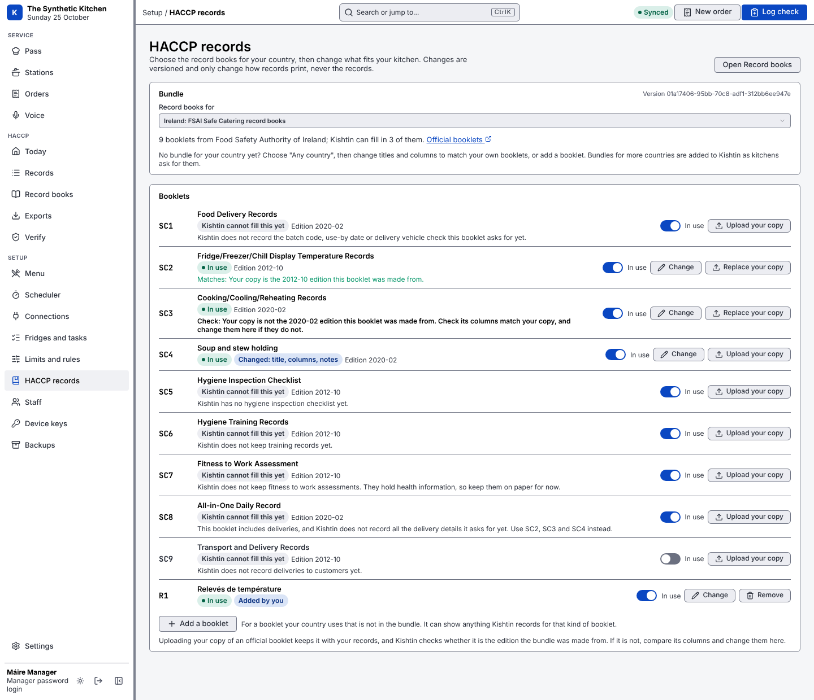
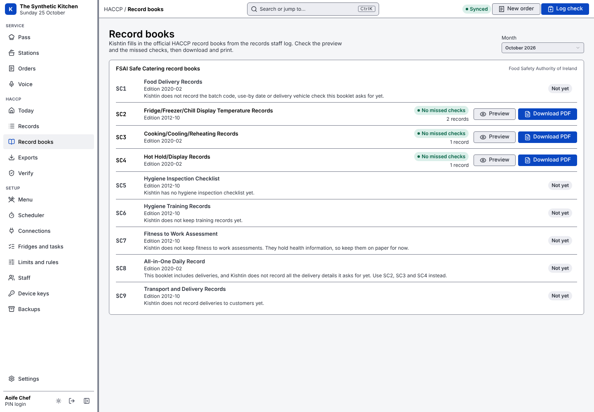

# Record books

Kishtin fills in official HACCP record books from the records staff log, so nobody has to copy readings onto paper.

Head chefs and managers only.

## Bundles

A bundle is one country's set of record books. Kishtin ships two:

| Bundle | For | Booklets |
|---|---|---|
| FSAI Safe Catering record books | Ireland (the default) | SC1 to SC9. Kishtin can fill in SC1, SC2, SC3, SC4 and SC8. |
| Kishtin general record books | Any country | T1 fridges and freezers, T2 cooking, cooling and reheating, T3 hot holding, T4 deliveries and T5 a daily record of all four, in plain English. Use these where no bundle for your country exists, and change titles and columns to match your own booklets. |

Bundles for more countries are added to Kishtin as kitchens ask for them. A bundle is a data file in `internal/books/bundles/`, so adding one or updating it for a new edition needs no code, as long as its booklets use the kinds of row Kishtin already has (below).

## Changing the booklets for your restaurant

**Setup › HACCP records** (manager password). Choose the bundle, then for each booklet:

- **In use**: turn a booklet off to hide it from Record books.
- **Change**:
  - Title.
  - Columns: rename, reorder, remove, add, set a group heading over several columns, or a blank column to fill by hand. A column can show anything Kishtin records for that kind of booklet. Widths are shares of the page.
  - Your own notes, printed under the booklet's notes.
  - Fridges and freezers per sheet.
  - Whether a manager check line prints.
- **Upload your copy**: upload the official PDF you use. Kishtin keeps it with your records and says whether it is the edition the bundle was made from (it compares the file's SHA-256). If it is not, compare its columns with the booklet and change them here.
- **Add a booklet**: for a booklet your country uses that is not in the bundle. Choose what it records (a fridge and freezer grid, a cooking log or a hot holding log), start from another booklet's columns, then change them.

Every change is shown before it is saved, needs a reason, and is saved as a new settings version, like limits. Each filled-in booklet names the settings version and what was changed. Changes only affect how records print; saved records never change. The same settings are available with `kishtin settings show record_books` and `kishtin settings set record_books`, and over the API at `/api/settings/record_books`.



## Kinds of booklet

| Kind | Rows | Fields a column can show |
|---|---|---|
| Fridge and freezer grid | A row per day, a column for each check on each fridge and freezer | day, readings, comments and actions, who logged |
| Cooking, cooling and reheating | A row per cooking (with its cooling) and per reheat | date, food, time cooking finished, core temperature, time into the fridge, reheat temperature, who logged each, comments, record number |
| Hot holding | A row per food per day, up to three checks | date, food, 1st/2nd/3rd check, comments, who logged, record number |
| Deliveries | A row per delivery | date, food item, batch code, supplier, use-by date, temperature (or "ambient"), delivery vehicle check, chilled/frozen/ambient, comments, who logged, record number |
| Daily record | A sheet per day, with a section for each of several other booklets in the bundle | none of its own: each section prints with that booklet's columns, as the restaurant set them, without the date column |

A booklet that needs another kind of row, such as a checklist or a training record, needs new code.

## What the FSAI bundle can fill in

| Booklet | Filled in | How |
|---|---|---|
| SC2 Fridge/Freezer/Chill Display Temperature Records | Yes | A month grid: a row per day, a column per check on each fridge and freezer (AM and PM, or the check times set in **Fridges and tasks**), six units per sheet. |
| SC3 Cooking/Cooling/Reheating Records | Yes | A row per cooking record. A cooling record joins the row of the same food cooked within an hour of its "cooked at" time; otherwise it gets its own row. Reheats get their own rows. |
| SC4 Hot Hold/Display Records | Yes | A row per food per day, with up to three checks. A fourth check starts a new row. |
| SC1 Food Delivery Records | Yes | A row per delivery. The batch code, use-by date and vehicle check come from the delivery record; any not recorded print blank. |
| SC8 All-in-One Daily Record | Yes | A sheet per day, from the first day records were kept up to today, with SC1, SC2, SC3 and SC4 sections for that day. The manager check line shows the sign-offs that cover that day. |
| SC5, SC6, SC7, SC9 | No | Kishtin does not record what they ask for yet. The screen says what is missing for each. |

Columns Kishtin does not record print blank, and the booklet says which ones they are:

- SC3 "Time started cooking" prints N/A when a core temperature is recorded, because the booklet says the start time is not needed then.
- SC4 "Time into hot hold" is always blank.

## What the pages show

- **Signed** is the first name of the person who logged the record.
- **FAIL** and **CHECK** mark failed and borderline readings, using the restaurant's limits saved with each record. The comments give the reason and the corrective action.
- **Corrections** show in place of the record they correct, with "Corrected" and the reason in the comments. Both records stay in the log.
- **missed** marks an SC2 check that was due and has no reading. Kishtin never fills a gap in. A check counts as missed once the next check has started (or the day has ended), and only for fridges and freezers on the managed list, from the first record ever logged. Kishtin does not know which days you were closed, so days you were closed show as missed.
- **Kishtin ref** (SC3, SC4) is the record number. The footer gives the record numbers used, the hash chain result and the chain head. Run `kishtin haccp verify` to check the records.
- The **Manager/Supervisor check** line lists the sign-offs that cover the month, and the days not signed off yet. With no sign-offs, it is left blank to sign by hand.

## Manager sign-off

A manager signs off the records for a period, for example each week. This is the "Manager/Supervisor check" of the paper booklets.

1. On **Record books**, the **Manager sign-off** card shows the last sign-off and the next period to sign: from the day after the last sign-off up to yesterday.
2. **Sign off records** (manager password) shows what the period holds: records, readings out of limit, readings without a corrective action and missed checks, with each one listed. Change the dates if needed.
3. If there are missed checks or readings without an action, a note is required saying what was done about them.
4. **Sign off** saves a `sign_off` record in the hash chain. It holds the period, the note and the counts as they were at that moment. Like every record, it cannot be edited or deleted. Signing a period again adds a second sign-off; both are kept.

Every record book prints the sign-offs that cover its month on the check line, with who signed, when, the period and the record number, and lists the days up to yesterday that no sign-off covers. The Today screen tells the head chef and manager when nothing has been signed off for 7 days or more.

From the command line: `kishtin haccp sign-off` shows the preview, and `kishtin haccp sign-off --from 2026-10-01 --to 2026-10-07 --note "..." --yes` signs. API: `GET /api/haccp/sign-offs/preview`, `POST /api/haccp/sign-offs`.

Only a manager logged in with a password (or a manager's API key) can sign off. A head chef can see the preview but not sign.

## On the screen



**Record books** under HACCP. Choose a month. Each booklet shows how many checks were missed and how many records it uses. **Preview** shows the filled-in sheets and a list of missed checks. **Download PDF** gives a landscape A4 PDF to print.

## From the command line

```
kishtin haccp books                              # the bundle in use, its booklets and what each needs
kishtin haccp book SC2 --month 2026-10           # missed checks and blank columns
kishtin haccp book SC2 --month 2026-10 -o sc2.pdf
kishtin haccp book SC4 --json                    # the filled-in pages as JSON
```

API: `GET /api/haccp/books`, `GET /api/haccp/books/{book}?month=YYYY-MM`, `GET /api/haccp/books/{book}/pdf?month=YYYY-MM`.

## What Kishtin does not do yet

- Hot food deliveries (SC1's "Hot food: at or above 63°C") are not a delivery kind yet: deliveries are chilled, frozen or ambient.
- Bundles ship with Kishtin. A restaurant can change booklets and add its own, but cannot load a new bundle file from the screens.
- Kishtin does not read the uploaded PDF. It only compares the file with the edition the booklet was made from, and does not check the FSAI site for new editions.
- It does not print onto the official PDF pages. It draws its own pages in the same layout.
- Ask your environmental health officer whether they accept printed or on-screen records in place of the paper booklets.
