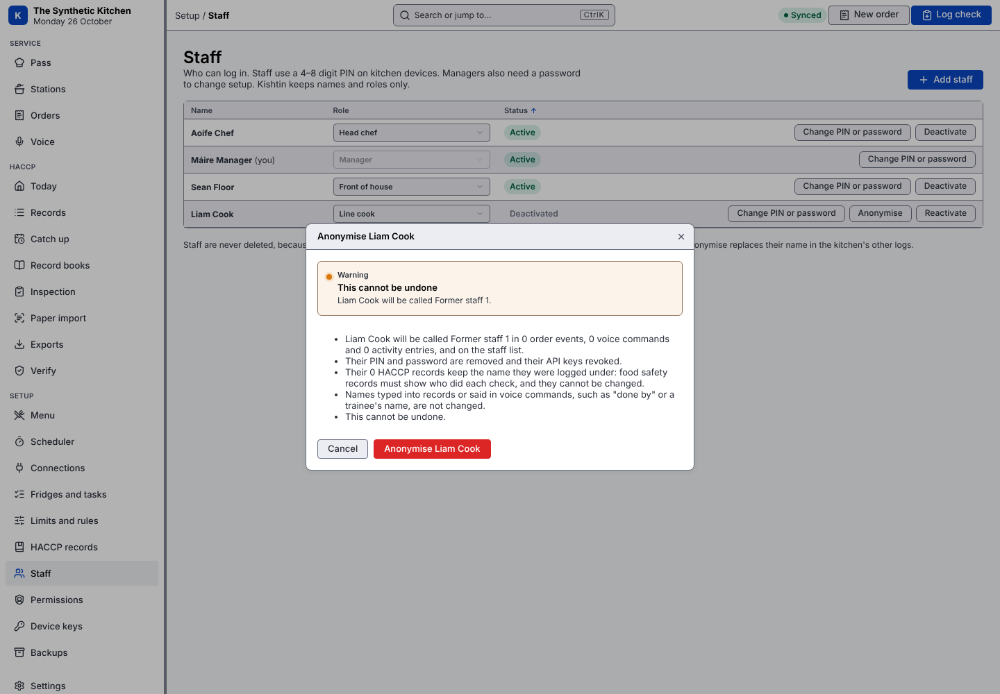

# What Kishtin records

Kishtin keeps most of what happens in the kitchen, even where nothing uses it yet, so future reports (and the restaurant's own questions) can look back on past services. Everything stays in the database file on the restaurant's machine. Nothing is sent anywhere.

This page lists what is kept, so staff can be told and a privacy notice can be written from it.

## HACCP records

Every check, with who logged it, when it was saved and when the check was done, the reading, the result, the limit and rules versions it was checked against, and any corrective action. Append-only and hash-chained; see [haccp.md](haccp.md). HACCP records are never changed, including when a leaver is anonymised.

## Orders and order events

Every order, course and item, and an event for every change: created, fired, started, ready, served, voided (with the reason), held, target moved, flagged urgent. Each event names who did it and the device it came from. Append-only.

## Scheduler plans

Each time the scheduler's plan changes, Kishtin keeps a snapshot: what each station was told to start and when, with the reason, and each fired course's status (on track, at risk, late, ready). A course at risk or late carries a cause:

| Cause | Meaning |
|---|---|
| `equipment_full` | the equipment it needs is full |
| `started_late` | an item was not started by its latest start |
| `cooking_long` | an item already started will be ready late |
| `waiting_at_pass` | the course is ready and has waited too long at the pass |
| `busy` | equipment is busy, with no single cause found |

The plan is checked after every order, menu or settings change and on the scheduler's re-plan timer (15 seconds by default), and kept only when what it recommends has changed, not when only the minutes in its wording move. Each snapshot names the strategy and settings version that produced it. Comparing snapshots with order events shows whether recommendations were followed and why courses ran late.

`kishtin plans --from 2026-10-24`, or `GET /api/kitchen/plans`. Head chef or manager.

## Activity log

Things staff and screens do that are not HACCP records or order events:

| Kind | Kept |
|---|---|
| `dish.sold_out`, `dish.back_on` | which dish, who, which device |
| `login`, `logout` | who, which device, PIN or password |
| `screen.connected`, `screen.disconnected` | which device and who was logged in; on disconnect, how many seconds it stayed connected. A screen that drops off the Wi-Fi shows as disconnected once the server notices, within about 20 seconds. |
| `haccp.entered` | for each HACCP record: how it was entered (`form`, `voice`, `catch_up`, `paper`, `api`), when the check was done and when it was saved |
| `staff.anonymised` | which leaver was anonymised, by whom, and how many entries changed |
| `setup` | when Kishtin was set up, by which manager, and whether from the screens or `kishtind setup` |
| `device.paired` | a tablet or phone paired by QR code: its name, its new device key, and the manager who made the code |

`kishtin activity --kind dish.sold_out`, or `GET /api/activity`. Head chef or manager (the "Exports, record books and the activity log" permission).

## Voice

The voice log keeps every command's transcript, what it was taken to mean, what happened, who said it and which device. Speech ignored in hands-free mode (not starting with the wake word) is never kept.

Recordings of spoken commands are **not** kept unless a manager turns it on: **Settings › Keep recordings of voice commands** (`voice_audio_days`, 0 to 365 days). Then each logged command's audio is kept on the server for that many days and deleted after. Recordings help check what was said and test speech models on the kitchen's own voices. Only a manager with a password can play one (`kishtin voice recording ID -o file`, `GET /api/voice/log/{id}/audio`). Tell staff before turning this on.

## Square

Every version of every till order Kishtin sees is kept, as Kishtin read it (lines, modifiers, ticket name, state), not only the latest. `kishtin square versions ORDER-ID`, `GET /api/square/orders/{id}/versions`. Card data never reaches Kishtin.

## Settings, limits and permissions

Every version of every setting, limit and permission, with who changed it, when and why. Nothing is edited in place.

## Leavers

When someone leaves, deactivate them in **Setup › Staff and access › Staff**. Then **Anonymise** replaces their name with "Former staff N":

- in order events, the voice log, the activity log and the staff list;
- their PIN and password are removed and their API keys revoked.

It shows what will change and asks first, and cannot be undone. Manager with a password only.

What it does not change:

- **HACCP records** keep the name they were logged under. Food safety records must show who did each check, and the hash chain proves they were not changed.
- Names typed into records or said in commands (a "done by" name, a trainee on a training record, a name in a transcript).
- Plan snapshots name tables and dishes, not staff.

`kishtin staff anonymise "Name"`, or `GET` then `POST /api/users/{id}/anonymise`.

## How long things are kept

Everything except voice recordings is kept until the restaurant deletes the database. HACCP records should be kept for as long as your inspector and HACCP plan require; Irish Revenue rules require business records for six years.

## What Kishtin does not record

- Card numbers or any payment data.
- Staff health details: fitness to work keeps only the outcome.
- Audio, unless recordings are turned on.
- Where anyone is, or anything about staff outside their use of Kishtin.
