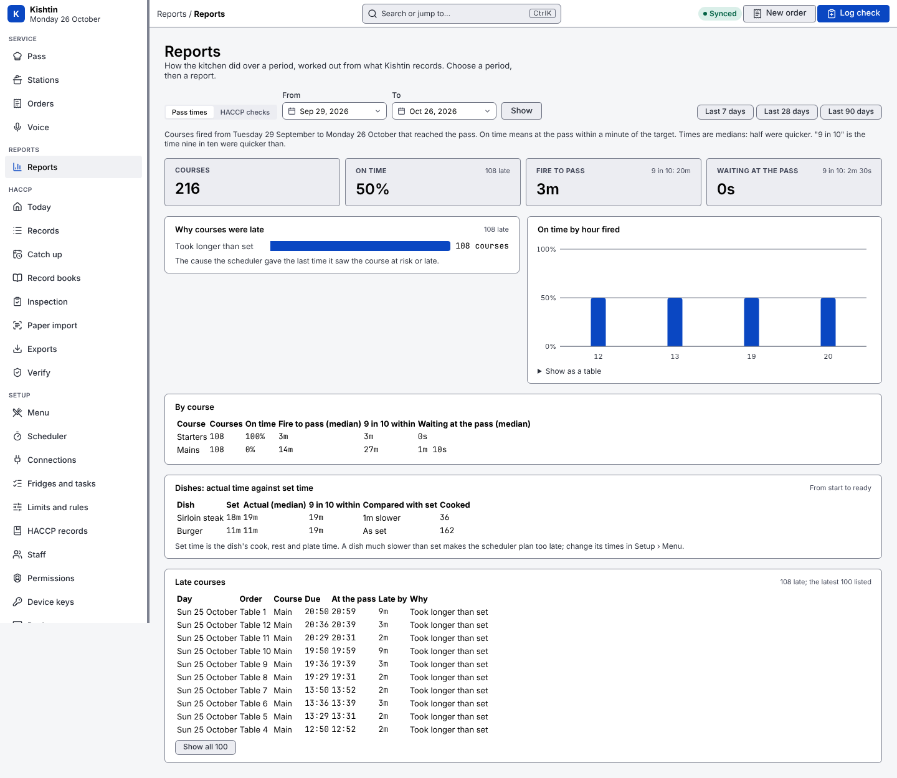
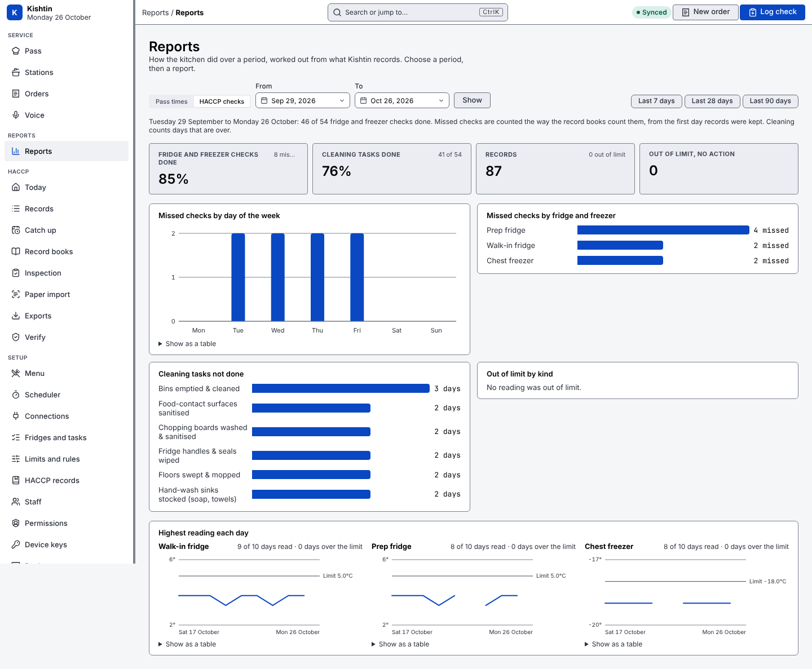

# Reports

**Reports** (in the sidebar) works out how the kitchen did over a period from what Kishtin records. Choose a period (the last 28 days by default, at most 366 days), then a report. Everything is worked out on the restaurant's own machine.

## Pass times



For courses fired in the period whose items all reached the pass (courses still cooking are left out):

- **On time**: the share at the pass within a minute of their target.
- **Fire to pass**: from firing the course to its last item reaching the pass.
- **Waiting at the pass**: from the last item reaching the pass to the course being served.
- **Why courses were late**: the cause the scheduler gave the last time it saw the course at risk or late (equipment full, started late, took longer than set, waited too long at the pass, equipment busy), from its kept plans. "No cause recorded" means no kept plan gave one, for example a course fired before plans were kept.
- **On time by hour fired**.
- **By course**: starters, mains and desserts.
- **Dishes: actual time against set time**: each dish's time from started to ready on the station screens, against its cook, rest and plate time. A dish much slower than set makes the scheduler plan too late; change its times in Setup › Menu. This is the groundwork for learned cook times, which Kishtin does not do yet.
- **Late courses**: the latest, with when each was due, when it reached the pass and why.

Times are medians (half were quicker), with the time nine in ten were quicker than. Head chef or manager (the "Run the pass" permission).

## HACCP checks



- **Fridge and freezer checks**: due, done and missed. Missed checks are counted the way the record books count them, from the first day records were kept; a check counts as done when its time slot has a reading, whenever it was entered.
- **Missed checks by day of the week** and **by fridge and freezer**.
- **Cleaning tasks done** and **not done**, by task, on days that are over.
- **Records**, **out of limit** and **out of limit with no corrective action**, and out of limit by kind.
- **Highest reading each day**, for each fridge and freezer, against its limit now. Days with no reading leave a gap.
- **Out-of-limit records**: the latest, each linking to the record.

Head chef or manager (the "Exports, record books and the activity log" permission).

Every chart shows its numbers on hover and has a table view.

## From the command line

```
kishtin report pass --from 2026-10-01 --to 2026-10-26
kishtin report haccp --json
```

API: `GET /api/reports/pass?from=&to=`, `GET /api/reports/haccp?from=&to=`.

## What reports do not do yet

- Reports are for the desk view; kitchen and phone layouts do not show them.
- No sales, covers or prep figures: those need orders from Square.
- No export to a spreadsheet or PDF; use `--json` from the command line.
- Station load and recommendations followed are recorded (see [recording.md](recording.md)) but not reported yet.
