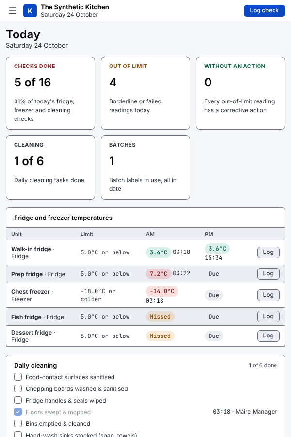

# Screens

`kishtind` serves the screens at its address (for example `http://kitchen-pc.local:8080/`). The layout is built for a computer screen: a sidebar on the left, a top bar with search and **Log check**, and tables with a details panel. The theme is light and high contrast by default. Every status shows as text plus colour.

Phones and tablets can open the same screens. Below 900 px wide, the sidebar becomes a menu button and pages stack into one column. A layout made for phones and kitchen tablets is not built yet.

## Pairing a device and logging in

1. A manager makes a device key in **Setup → Device keys** (or with `kishtin keys create --kind device --name "Office PC"`). The pairing link is shown once.
2. Open the link once on the computer, tablet or phone. The browser remembers the key. You can also paste the key on the setup screen.
3. Staff pick their name and enter their PIN. A PIN login lasts 12 hours. The exit icon at the bottom of the sidebar switches staff.

To take a device out of use, revoke its key in **Device keys**, or use **Unpair this device** in **Settings**.

## Layout

- **Sidebar**: Service (Pass, Stations, Orders); HACCP (Today, Records, Exports, Verify); Setup (Menu, Scheduler, Fridges and tasks, Limits and rules, Staff, Device keys, Backups); and Settings at the bottom. The Pass is the first page after logging in. The footer shows who is logged in and has the theme and switch-staff buttons. The collapse button shrinks the sidebar to icons, and the browser remembers that choice.
- **Top bar**: where you are, a search box, the connection, **New order** and **Log check**.
- **Search** (Ctrl K, or ⌘K on a Mac): jump to any page, start a new order, or start logging a check.
- **Log check** (Ctrl L, or ⌘L): opens the log form in a panel on the right.

The connection chip says:

- **Synced**: connected. New records from any device appear straight away.
- **Connecting…**: reconnecting.
- **Not saving**: the server cannot be reached, or the last save failed. A "Not connected" notice says when the data on screen was last updated. Records cannot be saved until the connection is back.

Each page has its own address, such as `/records?range=31&id=…`, so you can bookmark it and the back button works.

## Service

How the kitchen side works, and how the scheduler decides, is in [kitchen.md](kitchen.md). The Pass and Stations refresh after every change on any device and every 15 seconds, and their countdowns tick every second.

### Pass

Every open order as a card, for the head chef or expo:

- **Figures**: open orders, and how many fired courses are on track, at risk, late, or ready to serve, and how many courses are held.
- **Show**: all orders, only those that need action (at risk, late or ready), or those with held courses.
- Each card shows the table or takeaway, ticket number, time entered, covers, notes, and an **Allergy** chip and red edge when flagged. Each course shows its state and the scheduler's status (on track, at risk, late, ready) with the reason, the target time with a countdown, and its items grouped as "2× Burger (Well done)" with their state.
- Head chefs and managers get the buttons: **Fire** a held course; **Serve** a course once every item is ready; **Change time** (a new target, with a reason for the log); **Urgent**; and **Close order** once everything is served or voided. Other staff see the same cards without buttons.
- The history icon opens the order: its courses and items, its full history (who did what, when), and **Add items**.

### Stations

Pick a station. Three columns:

- **Start now**: what the scheduler says to start, such as "3× Burger on the flat-top for Table 4 and Takeaway #3", with the reason, and **Start** (or **Start all 3**). A card that is already past its latest start is marked **Late**.
- **In progress**: items cooking, resting or plating, grouped when they finish together, with a countdown to the end of the phase (red when overdue) and **Done cooking**, **Done resting** or **Ready**.
- **Coming up**: what to start later and when, with a countdown, the reason, and **Start early**.

Line cooks, head chefs and managers get the buttons.

### Orders

- **New order** (front of house, head chefs and managers): table or takeaway, table number or customer name, covers, an allergy tick and notes. Tap dishes to add them, grouped by course; dishes that are 86 cannot be added. Each line has a quantity, its course, modifier chips and notes. Head chefs and managers can tick courses to **fire straight away**. **Send order** shows the ticket number.
- **Today's orders**: open orders, or every order today, sortable. Select one to open it, with its history and **Add items**.

## Today

- **Figures**: checks done out of due, out-of-limit readings today, how many of those have no corrective action, cleaning tasks done, and batches in use.
- **Fridge and freezer temperatures**: one row per unit, with its limit and a column for each check time. Each check shows the reading (green pass, amber borderline, red fail), **Due**, or amber **Missed** once the next check has started. **Log** opens the log form with that unit chosen.
- **Daily cleaning**: tick a task to record it as done, with your name and the time. Each task can be done once a day.
- **Needs attention**: today's failed and borderline records, why, and the corrective action. Select a record to open it in Records.
- **Batches in use**: batch labels with a use-by date from three days ago onwards: Expired, Use today, or OK.

Check times are set per unit in **Fridges and tasks**. By default each unit has an AM check (until 12:00) and a PM check.

## Log check

Choose a type: Fridge / freezer, Delivery, Cook / reheat, Cooling, Hot holding, Batch label or Cleaning. As you type, a box shows the result the server will record (pass, borderline or fail) and which limit it used.

- **Delivery**: tick **Packaging intact** and **In date**. Leaving either unticked fails the delivery. **Add docket photo** attaches a photo or PDF.
- **Cooling**: enter when cooking finished and when the food went into the fridge (**Now** fills in the time). A fridge time earlier than the cooking time counts as over midnight. If more than 2 hours passed, enter the core temperature at 2.5 hours.
- **Batch label**: the use-by date is the made-on date plus the shelf life in days (5 by default).

If the result is not a pass, a corrective action is required. Pick a quick-pick action or write your own. **Save record** stays off until there is a result and, if needed, an action.

## Records

A table of every record, newest first. You can:

- Search by fridge, food, supplier, staff member or action.
- Filter by Today, 7 days, 31 days or All, and by type, or show only borderline and failed records.
- Sort by any column.

Select a record to open its details panel:

- The reading, the result and why, the corrective action, and where the limit came from.
- The docket photo, if there is one.
- The evidence: record ID, hash, previous hash, limit version and rules version, each with a copy button.

**Correct this record** opens the log form filled in from the record, with a required reason. Saving adds a new record that points to the original. The original never changes; the table marks it **Corrected** and the new one **Correction**.

## Exports

Head chefs and managers only.

1. Choose a date range (or every record), a record type, and whether to include only borderline and failed records.
2. Check the preview: how many records match, failed, borderline, without an action, and a count per type.
3. Download one of these:
   - **Inspection pack (PDF)**.
   - **Records (CSV)**.
   - **Limit history (CSV)**: every limit version ever saved.

After a download, **Last export** shows how many records the file has, whether the hash chain verified, and the chain head. Keep the chain head with the file.

The preview counts at most 1000 records. The export itself has no limit.

## Verify

Re-checks three things:

- The hash chain from the first record.
- Every attached file against its SHA-256.
- That every limit version a record points to exists.

It runs when you open the page, and again with **Check again**. If something does not match, the page shows the first break and links to that record. It also says what verify cannot catch: records removed from the end of the chain. See [haccp.md](haccp.md#records-cannot-be-changed).

## Setup

Everyone can see **Menu**, **Scheduler**, **Fridges and tasks** and **Limits and rules**. Changing them, and opening **Staff**, **Device keys** and **Backups** at all, needs a manager logged in with their password. Use **Manager login** on the page. That logs this device in as the manager for 30 minutes.

- **Menu**: a card per station with its equipment and how many each holds, and every dish in a sortable table with its course, station, equipment and capacity, cook time, total time, how long it can wait, and status (Available, 86, off the menu). **Add station**, **Add equipment**, **Add dish** and **Edit** need the manager password. The dish form takes times in minutes or minutes:seconds, the food category from the HACCP lists, and modifiers with their extra cook minutes. **86** and **Back on** are open to head chefs, line cooks and managers.
- **Scheduler**: the strategy, batching, priorities, how long a ready course can wait at the pass, how often screens re-plan, and a buffer per station. **Review changes** shows what changes before saving with a reason. A card lists what the scheduler does not do yet.
- **Fridges and tasks**: fridges and freezers with their check times, and which fridges are non-food; daily cleaning tasks and their areas; food categories; quick-pick corrective actions per record type. Edit freely, then **Review changes** shows what changes and what it affects, and asks for a reason before saving.
- **Limits and rules**: the limits in use, and the full history with who changed each one and why.
  - **Change** or **New limit** opens the limit form. It covers fridge and freezer maximums, delivery borderlines, hot-holding minimums, cooking time–temperature combinations and cooling times, for a dish, food category, unit or every one.
  - **Preview the change** shows what it replaces, any warning that it is below your guidance or the FSAI defaults, and how recent records would have scored under it.
  - A reason is always needed. A HACCP plan reference is needed when the limit is less strict than your guidance.
  - The food-safety rules are toggles, reviewed the same way.
  - The reference guidance is changed with `kishtin settings set guidance`.
- **Staff**: add staff with a role and a PIN (managers also get a password of at least 10 characters), change roles, change a PIN or password, and deactivate or reactivate. Staff are never deleted, because records name who logged them.
- **Device keys**: make device keys and staff keys for the CLI. The key and pairing link are shown once. You can revoke a key.
- **Backups**: the latest backup, the schedule, and every backup on the server with its record count, size, verify result and chain head. **Back up now** makes one straight away.

## Settings

- **Restaurant**: the name, backup schedule and retention, largest upload, and preview length. These change through the same review as Setup. See [settings.md](settings.md#system-settings).
- **This device**: light, dark or system theme, high contrast, and unpairing.

## Screenshots

All taken with synthetic data at 1440 × 960.

| Pass | Stations: the grill |
|---|---|
|  |  |
| **Station with burgers cooking** | **Order history** |
|  |  |
| **New order** | **Menu** |
|  |  |
| **Changing a dish** | **Scheduler** |
|  |  |
| **Today** | **Records, with a record selected** |
|  |  |
| **Log check** | **Correcting a record** |
|  |  |
| **Search** | **Verify** |
|  |  |
| **Exports** | **Limits and rules** |
|  |  |
| **Changing a limit** | **Fridges and tasks** |
|  |  |
| **Staff** | **Device keys** |
|  |  |
| **Backups** | **Settings** |
|  |  |

At 600 px wide the same screens stack into one column, as below. A layout designed for phones is still to come.

