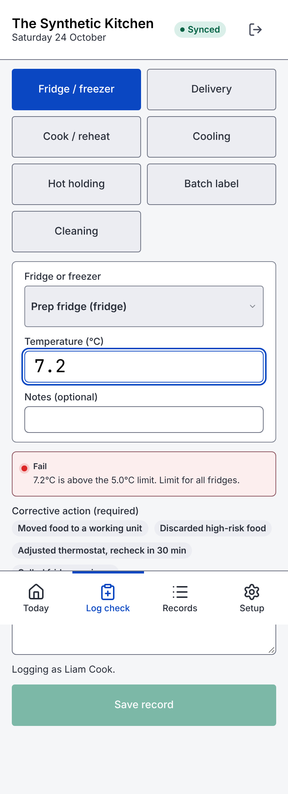
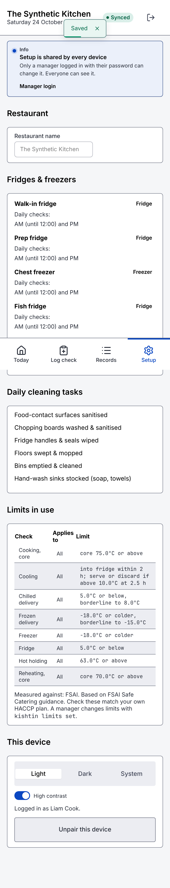
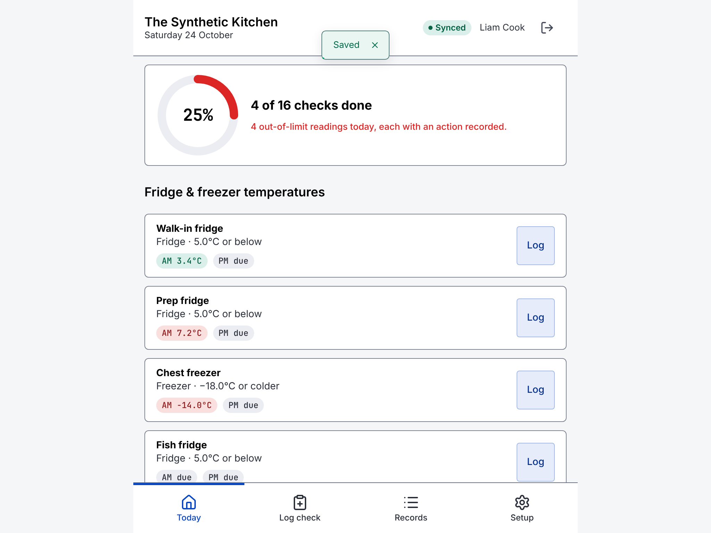

# Kitchen screens

`kishtind` serves the screens at its address (for example `http://kitchen-pc.local:8080/`). They are built for phones and tablets: large buttons (at least 56 px tall), big numbers for temperatures, a light high-contrast theme by default, and a status that is always text plus colour.

There are four tabs: **Today**, **Log check**, **Records** and **Setup**.

## Pairing a device and logging in

1. A manager makes a device key: `kishtin keys create --kind device --name "Pass tablet"`. It prints a pairing link.
2. Open the link once on the tablet or phone. The device remembers its key. (Or paste the key on the setup screen.)
3. Staff tap their name and enter their PIN. A PIN login lasts 12 hours; tap the exit icon in the header to switch staff.

To take a device out of use, revoke its key (`kishtin keys revoke ID`) or tap **Unpair this device** in Setup.

## Header

The restaurant name, today's date, and the connection:

- **Synced**: connected; new records from any device appear straight away.
- **Connecting…**: reconnecting.
- **Not saving**: the server cannot be reached, or the last save failed. A "Not connected" notice says when the data on screen was last updated. Records cannot be saved until the connection is back.

The screen stays awake while it is open, where the browser allows it.

## Today

- **Checks done**: a ring with the share of today's checks done. A check is each fridge or freezer check time plus each cleaning task. The ring is red if any reading today was out of limit, green when every check is done, and blue otherwise.
- **Fridge & freezer temperatures**: one row per unit with its limit and a pill per check: the reading (green pass, amber borderline, red fail), "due", or amber "missed" once the next check has started. **Log** opens Log check with that unit chosen.
- **Daily cleaning**: tick a task to record it as done, with your name and the time. Each task can be done once a day.
- **Needs attention**: today's failed and borderline records with their corrective actions.
- **Batches in use**: batch labels with a use-by date from three days ago onwards, newest first: Expired, Use today, or OK.

Check times are set per unit in Setup. By default each unit has an AM check (until 12:00) and a PM check.

## Log check

Choose a type: Fridge / freezer, Delivery, Cook / reheat, Cooling, Hot holding, Batch label or Cleaning. As you type, a box shows the result the server will record (pass, borderline or fail) and which limit it used.

- **Delivery**: tick **Packaging intact** and **In date**; either one unticked fails the delivery. Add a docket photo with the camera button.
- **Cooling**: enter when cooking finished and when the food went into the fridge (**Now** fills in the time). A fridge time earlier than the cooking time counts as over midnight. Over 2 hours, enter the core temperature at 2.5 hours.
- **Batch label**: the use-by date is the made-on date plus the shelf life in days (5 by default).

If the result is not a pass, a corrective action is required. Tap a quick-pick action or write your own. **Save record** stays off until there is a result and, if needed, an action.

## Records

Filter by Today, 7 days, 31 days or All, and by type or fails only. Records are grouped by day, newest first. Head chefs and managers can download the current filter as CSV or as the PDF inspection pack.

## Setup

Everyone can see Setup. Changing it needs a manager logged in with their password: tap **Manager login**. That logs the device in as the manager for 30 minutes.

- Restaurant name.
- Fridges and freezers, with their check times.
- Daily cleaning tasks.
- The limits in use, and the reference guidance they are measured against (read only here; a manager changes limits with `kishtin limits set`).
- This device: light, dark or system theme, high contrast, and unpairing.

Every change is reviewed before it is saved: what changes, what it affects, and a reason. See [settings.md](settings.md).

## Screenshots

With synthetic data, at phone size unless noted.

| Today | Log check (a failed reading) | Records | Setup |
|---|---|---|---|
|  |  |  |  |

