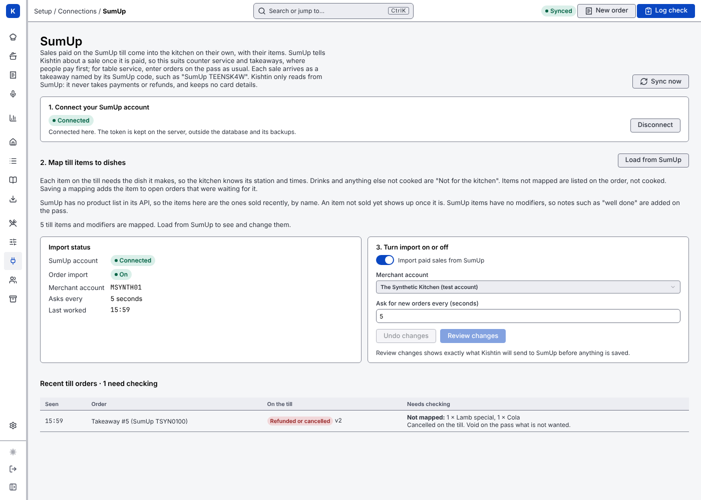

# Sales from SumUp

Sales paid on a SumUp till or card reader come into the kitchen on their own, with their items.

**SumUp tells Kishtin about a sale only once it is paid.** That suits counter service, cafés and takeaways, where people pay when they order. For table service, where people pay at the end, the food has to be cooked long before SumUp knows about it: enter those orders on the pass as usual.

Kishtin only **reads** from SumUp. It never takes payments, never issues refunds, and keeps no card details. SumUp's answers include payment details such as the card type and last four digits; Kishtin reads only the items and throws the rest away.

## What happens to a sale

1. Every few seconds (5 by default) Kishtin asks SumUp for sales paid, refunded or cancelled since it last asked, then asks for each of those sales by its ID to read its items.
2. A paid sale becomes a kitchen order:
   - It is a **takeaway** named by its SumUp code, such as "SumUp TEENSK4W". SumUp has no tables.
   - Each item becomes the dish it is mapped to (see below). Items marked **not for the kitchen**, such as drinks, are left out. A sale with nothing for the kitchen does not become an order.
   - Its courses are **held** until the pass fires them. The order's history shows "SumUp" as who entered it.
3. A sale refunded or cancelled on SumUp is **never voided automatically**: the food may already be cooking. Kishtin adds a note to the order ("SumUp: Cancelled on the till") and the pass decides.
4. Sales are deduped on SumUp's transaction ID and status, so a sale is never entered twice.

An item that is not mapped yet is not cooked. It is listed on the order's notes and on the SumUp page, and once a manager maps it, it is added to the open order.

## If SumUp or the internet is down

Manual orders keep working. The SumUp page shows **SumUp did not answer** with the reason. Kishtin keeps asking, backing off up to every two minutes, and carries on from where it left off when SumUp answers.

## Setting it up

Everything is on **Setup → Connections → SumUp**, for a manager logged in with the password.

1. **Connect your SumUp account.** In SumUp's dashboard (me.sumup.com), open **Settings → For Developers → Toolkit → API Keys** and create a key. Paste it and **Check and connect**. Kishtin sends the key to SumUp and asks which merchant accounts it reaches. If SumUp refuses it, nothing is saved. If it accepts, the key is kept in a file in the data folder that only the server can read (`connectors/sumup.json`), outside the database, so it is never in a backup or export. A SumUp API key can do everything on the account, so keep it to managers.
2. **Map items to dishes.** **Load from SumUp** reads up to 60 paid sales from the last 30 days and lists the items in them. Map each to the dish it makes, or mark it **Not for the kitchen**, and **Save changes**.
3. **Turn import on.** Switch on **Import paid sales from SumUp**, choose the merchant account, and **Review changes**. The review says exactly what Kishtin will send to SumUp and what comes back. Save it with a reason.

Only sales changed after import is turned on are imported.



**Disconnect** deletes the saved key. Turn import off first. Mappings and orders already imported stay.

The key can instead be set on the server, as `KISHTIN_SUMUP_TOKEN` or `sumup.token` in `kishtin.toml`. A key set there wins, and the screens cannot change or disconnect it. Connect from a device that reaches the server over HTTPS, or on the server itself, so the key does not cross the Wi-Fi in the clear.

## Commands

```sh
kishtin connectors connect sumup --token-file key.txt   # or --token-file - for standard input
kishtin connectors disconnect sumup
kishtin sumup locations                  # merchant accounts the key reaches
kishtin sumup status                     # on or off, last worked, recent sales
kishtin sumup catalog                    # items sold recently, and their mapping
kishtin sumup map "name:flat white" --ignore   # or --dish Burger
kishtin sumup sync                       # ask SumUp now
kishtin sumup versions TRANSACTION-ID    # every version of a sale Kishtin has seen
kishtin settings set sumup -f sumup.json --reason "Go live"
```

`sumup.json` holds `{"enabled": true, "location_id": "MH4H92C7", "poll_seconds": 5}`, where `location_id` is the merchant code.

API: `PUT` and `DELETE /api/connectors/sumup`, and `/api/tills/sumup`, `/api/tills/sumup/locations`, `/api/tills/sumup/catalog`, `PUT /api/tills/sumup/mappings`, `POST /api/tills/sumup/sync`, `/api/tills/sumup/orders/{id}/versions`, and `/api/settings/sumup` for the setting.

## What it does not do

- Orders before payment. SumUp's public API only reports transactions, which exist once a sale is paid.
- SumUp POS Pro (formerly Goodtill). It has no public API, so Kishtin cannot read from it.
- Modifiers. SumUp's transactions list items by name and quantity only, so "well done" and similar are added on the pass.
- A product list. SumUp's API has none, so the catalog is built from items sold recently. An item that hasn't sold yet appears once it does.
- Partial refunds. A refund of one item from a sale is not tracked; only a fully refunded or cancelled sale is noted.
- Items are matched by name. Renaming an item on SumUp makes it a new item to map.
- SumUp's sandbox. Test accounts work with production keys; Kishtin marks them "(test account)".
